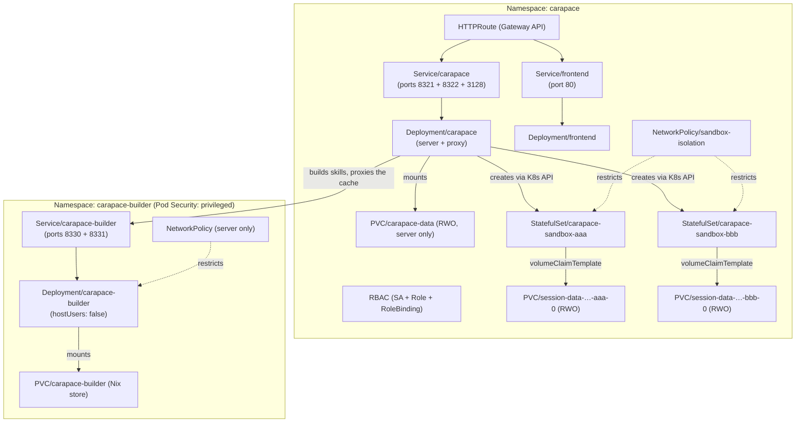

# Kubernetes Deployment

carapace supports Kubernetes as a sandbox runtime. Instead of Docker containers, sandbox sessions run as Kubernetes StatefulSets with per-session PVCs. Each session gets its own PersistentVolumeClaim via `volumeClaimTemplates`, eliminating the need for a shared RWX volume.

Upgrading an install from before skill flakes? Follow [Upgrading to skill flakes](upgrading-to-skill-flakes.md) first.

## Prerequisites

- **Kubernetes cluster** (1.29+) — tested with k3s, works with any conformant cluster. Sandbox file writes need the `v5.channel.k8s.io` exec subprotocol (1.29+, see [Architecture](#architecture)), and the in-cluster builder needs user namespaces for pods (below).
- **RWO StorageClass** — any standard ReadWriteOnce provisioner. The server pod has its own data PVC; sandbox sessions each get a dedicated PVC.
- **Container images** pushed to a registry accessible by the cluster (GHCR by default)
- **Helm 3** installed locally
- **User namespaces for pods** on the nodes that run the [skill builder](builder.md#kubernetes) (`hostUsers: false`, `procMount: Unmasked`), and Pod Security level `privileged` for it. The chart puts the builder into its own namespace, `<release namespace>-builder`, so the release namespace can enforce `baseline` (see [Pod security](#pod-security)). Or run the builder on a separate machine and set `builder.enabled: false`.
- Published application images support **Linux x64**; native ARM Linux builds are a local development target.

## Quick start

```bash
# 1. Create a secret with your API key and bootstrap admin password (or use an ExternalSecret / SealedSecret).
#    The ANTHROPIC_API_KEY line is optional: drop it and the server still starts, so an admin can
#    configure the model catalog under Settings -> Admin -> Models first.
kubectl create namespace carapace
kubectl label namespace carapace pod-security.kubernetes.io/enforce=baseline
kubectl create secret generic carapace-secrets -n carapace \
  --from-literal=ANTHROPIC_API_KEY=sk-ant-... \
  --from-literal=CARAPACE_TOKEN=my-bootstrap-admin-password

# 2. Create the Postgres credentials Secret (recommended; required under GitOps — see Database below)
kubectl create secret generic carapace-postgres -n carapace \
  --from-literal=postgres-password="$(openssl rand -base64 24)" \
  --from-literal=database-url='postgresql+psycopg://carapace@carapace-postgres:5432/carapace'

# 3. Install from OCI registry, referencing the secrets
helm install carapace oci://ghcr.io/thiesgerken/charts/carapace \
  --namespace carapace \
  --set ingress.hostname=carapace.example.com \
  --set 'envFrom[0].secretRef.name=carapace-secrets' \
  --set postgres.auth.existingSecret=carapace-postgres \
  --set postgres.image.tag=19-alpine

# 4. Upgrade to a new version
helm upgrade carapace oci://ghcr.io/thiesgerken/charts/carapace -n carapace
```

> The `database-url` host (`carapace-postgres`) is `<release>-postgres`; the username
> (`carapace`) must match `postgres.auth.username`. The URL omits the password — it is
> injected separately as `PGPASSWORD` from `postgres-password`, so no URL-encoding is
> needed. With plain Helm you can skip step 2 and let the chart auto-generate the
> password, but do **not** do that under GitOps (see Database).

Inject additional environment variables via `extraEnv` (inline values) or `envFrom` (external Secrets / ConfigMaps). Platform and user settings are managed from the web UI after install; the server data PVC uses the cluster's default StorageClass unless overridden with `persistence.data.storageClassName`.

Session-list caching requires Redis. The Helm chart deploys an in-cluster Redis by default and wires `CARAPACE_CACHE_REDIS_URL` automatically; if you disable it, point carapace at an external Redis instance with `extraEnv` or `envFrom`.

Kubernetes credential backends can be deployed through the Helm chart too. For Bitwarden/Vaultwarden, the chart runs separately addressable vault proxies protected by HTTP Basic Auth and NetworkPolicy.

See the [chart README](../charts/carapace/README.md) for installation details and the full values reference.

## Application runtime hardening

The server, frontend, and Bitwarden pods run as UID/GID/fsGroup **999**, with `runAsNonRoot` and seccomp `RuntimeDefault`. Their containers use a read-only root, disable privilege escalation, drop all capabilities, and mount an `emptyDir` at `/tmp`. The server and Bitwarden data mounts remain writable. The server UID and data-volume fsGroup stay 999. For legacy root-owned Bitwarden files, kubelet's default `fsGroupChangePolicy: Always` recursively applies group 999 and group read/write permissions on mount, so existing PVCs do not need a manual ownership migration.

The server retains its service account token for sandbox lifecycle operations. Frontend and Bitwarden pods disable token automounting. The Bitwarden nginx proxy uses the unprivileged image and listens on 8080; its Service still defaults to 80. The frontend likewise listens on 8080 behind its port-80 Service. Postgres and the sandbox image (Nix-built, the agent is root in it) are not changed by this hardening.

Bitwarden API-key login requires Vaultwarden 1.35.5 or newer. If Bitwarden persistence is disabled, its state gets an `emptyDir`, not the read-only root.

## Architecture



The server pod manages sandbox StatefulSets directly via the Kubernetes API. Each session gets its own StatefulSet (replicas=1) with a per-session PVC created via `volumeClaimTemplates`. Commands are executed in the pod `{sts-name}-0` via `kubectl exec`. File writes, `str_replace` and uploads pass their data on the exec's stdin, in one exec per file. That needs the `v5.channel.k8s.io` exec subprotocol (Kubernetes 1.29 or newer), the only one that can close stdin. kr8s speaks only v4, so carapace opens that websocket itself and fails loudly if the API server doesn't agree to v5.

Sandbox StatefulSets get an `ownerReference` so they show under the owning object in Argo CD and are garbage-collected when that object is deleted.

When `CARAPACE_SANDBOX_K8S_SANDBOXES_NAME` is set, the server requires that namespaced **`Sandboxes`** custom resource to exist and uses it as owner. If the named CR is missing or unavailable, sandbox creation fails.

Set `CARAPACE_SANDBOX_K8S_SANDBOXES_NAME` to `null` or an empty string to use the server `Deployment` (`CARAPACE_SANDBOX_K8S_SERVER_DEPLOYMENT_NAME`) as owner instead.

The `Sandboxes` CR is currently an ownership/metadata anchor only. There is no operator/controller reconciling sandbox resources yet; the carapace server still creates/scales/deletes sandbox StatefulSets directly.

Set **`CARAPACE_SANDBOX_K8S_OWNER_REF=false`** to omit `ownerReferences` entirely (Argo CD still associates sandboxes via `argocd.argoproj.io/tracking-id`).

### Idle lifecycle

When a session is idle (`CARAPACE_SANDBOX_IDLE_TIMEOUT_MINUTES`, default 60 min; the chart sets 960 through `sandbox.idleTimeoutMinutes`), the StatefulSet is scaled to **0 replicas**. The PVC is retained (`whenScaled: Retain`), preserving the workspace and all session files. When the session resumes, the StatefulSet is scaled back to 1 replica; the pod mounts the existing PVC, so no git clone is needed. Anything kept outside the PVC is gone; the skill commands come back with the profile sync (see [sandbox.md](sandbox.md#container-lifecycle)).

If `CARAPACE_SANDBOX_WARM_POOL_SIZE` is greater than `0`, the server also keeps that many unattached generic warm sandboxes ready. New sessions can claim one of those prestarted StatefulSets instead of waiting for a full cold start. After a successful claim, carapace immediately refills the pool toward the configured target. The claimed sandbox keeps its original unique `sandbox_id` such as `pool-3f9c…`, which is persisted in the session snapshot and shown in the web UI's sandbox inspector. If a claim fails (for example the knowledge repo clone fails), the claimed pool StatefulSet is deleted and the session falls back to a cold-created sandbox. StatefulSets that are already being deleted are ignored when resolving a session's sandbox. Two live StatefulSets labelled with the same session are treated as an error for that session only: starting its sandbox fails until one of them is removed manually, while other sessions are unaffected. Startup orphan cleanup removes every StatefulSet of a deleted session.

When a session is permanently deleted (or the user runs `/reload`), the entire StatefulSet is deleted. The PVC is automatically cleaned up via the retention policy (`whenDeleted: Delete`).

Nothing else frees a scaled-down sandbox, so abandoned sessions keep their PVC. `CARAPACE_SANDBOX_MAX_PER_USER` (Helm: `sandbox.maxPerUser`, default `100`) caps the StatefulSets one user holds, running or scaled to 0. Unclaimed warm-pool members belong to no user and don't count. At the limit, a session without a sandbox can't get one (neither a warm claim nor a cold create) until the user deletes old sessions; scaling an existing StatefulSet back up is never refused. See [sandbox.md](sandbox.md#per-user-sandbox-limit).

### Changing the sandbox image

`CARAPACE_SANDBOX_BASE_IMAGE` is read at server startup, so an image change takes effect with the server rollout. Existing sandbox StatefulSets are brought in line as follows:

- **Unclaimed warm-pool members** hold no user data. Pool maintenance (at startup and every 60 s) deletes members whose pod template uses a different image and refills the pool from the configured one. Until then, new sessions skip stale members when claiming and fall back to another member or a cold create.
- **Session sandboxes scaled to 0** get their pod template switched to the configured image right before they are scaled back up. Scaling up from 0 starts a fresh pod anyway, and the workspace and `/tmp` live on the PVC, so nothing is lost.
- **Running session sandboxes** are never touched. They pick up the new image the next time they are resumed after an idle scale-down.

Images are compared as plain reference strings. Re-pushing a mutable tag such as `:latest` under the same name is not detected, which is another reason to pin a specific version tag.

### Instance label

The server lists, cleans up and claims only StatefulSets labelled `carapace.instance=<CARAPACE_SANDBOX_INSTANCE>` (default `default`), so releases with different instances can share a namespace (see [sandbox.md](sandbox.md#instances)). Sandboxes created before the label existed don't have it, and a server would neither find them nor clean them up. Label them once before upgrading from a version without it:

```bash
kubectl -n carapace label sts -l app.kubernetes.io/managed-by=carapace-server carapace.instance=default
```

Only StatefulSet metadata changes (the selector and the pod template stay as they are), so nothing rolls out and the PVCs are untouched. Use your instance name instead of `default` if you set one.

## Configuration

All operator settings are configured via environment variables (there is no `config.yaml`); sandbox settings use the `CARAPACE_SANDBOX_` prefix. This keeps deployment-specific settings separate from UI-managed runtime data on the server PVC.

Set the following env vars on the server pod:

```yaml
env:
  - name: CARAPACE_SANDBOX_RUNTIME
    value: kubernetes
  - name: CARAPACE_SANDBOX_BASE_IMAGE
    value: ghcr.io/thiesgerken/carapace-sandbox:latest # pin this to a specific version!
  - name: CARAPACE_SANDBOX_WARM_POOL_SIZE
    value: "1" # keep one generic warm sandbox ready for faster claims (Helm: sandbox.warmPoolSize)
  - name: CARAPACE_SANDBOX_MAX_PER_USER
    value: "100" # sandboxes (and session PVCs) one user may hold, 0 = unlimited (Helm: sandbox.maxPerUser)
  - name: CARAPACE_SANDBOX_WARN_PER_USER
    value: "20" # sidebar warns from this many sandboxes on, 0 = never (Helm: sandbox.warnPerUser)
  - name: CARAPACE_SANDBOX_K8S_NAMESPACE
    value: carapace
  - name: CARAPACE_SANDBOX_K8S_PVC_CLAIM
    value: carapace-data
  # - name: CARAPACE_SANDBOX_K8S_SERVICE_ACCOUNT
  #   value: ""  # optional SA for sandbox pods
```

When `CARAPACE_SANDBOX_RUNTIME` is unset or `docker` (the default), the server uses the Docker socket.

The Helm chart sets the session-list cache URL automatically when bundled Redis is enabled. For an external Redis, configure `CARAPACE_CACHE_REDIS_URL` through `extraEnv` or `envFrom`:

```yaml
extraEnv:
  - name: CARAPACE_CACHE_REDIS_URL
    value: redis://redis.example.internal:6379/0
```

The bundled Redis Service name is `<release>-redis`, so the in-cluster URL is `redis://<release>-redis:6379/0`. If you set `redis.enabled=false`, provide an external Redis URL with `CARAPACE_CACHE_REDIS_URL`.

> **Important:** Always pin the sandbox image to a specific version tag (e.g. `:0.25.1`). Using `:latest` in production can lead to version mismatches between the server and sandbox image.

### Bitwarden / Vaultwarden credential backends

The chart can run Bitwarden CLI (`bw serve`) instances for the `bitwarden` credential backend. Each instance uses a Kubernetes Secret containing Bitwarden login material, mounted as files under `/run/secrets/bitwarden`:

```bash
kubectl create secret generic carapace-bw-personal -n carapace \
  --from-literal=BW_CLIENTID=user.xxxxxxxx-... \
  --from-literal=BW_CLIENTSECRET=xxxxxxxxxxxx \
  --from-literal=BW_MASTER_PASSWORD=your-master-password \
  --from-literal=BW_EMAIL=you@example.com
```

Each user can get a separate Service, Basic Auth boundary, Secret, and PVC. The Bitwarden CLI binds to the fixed localhost-only internal port `8088` inside its own Pod; nginx listens on `8080`, and the Service exposes the configured port (default `80`). NetworkPolicy allows the nginx pod port only from the carapace server Pod.

Create the proxy auth Secret separately. It must contain an htpasswd file named `htpasswd` unless you override `basicAuth.secretKey`:

```bash
htpasswd -nB alice > /tmp/carapace-bitwarden-alice-htpasswd
kubectl create secret generic carapace-bitwarden-alice-basic-auth -n carapace \
  --from-file=htpasswd=/tmp/carapace-bitwarden-alice-htpasswd
```

Then enable an instance with user-specific names in the Helm values:

```yaml
bitwarden:
  persistence:
    enabled: true
    size: 256Mi
    finalizers:
      - kubernetes.io/pvc-protection
  instances:
    - name: vaultwarden-alice
      fullnameOverride: carapace-bitwarden-alice
      serverUrl: https://vault.example.com
      existingSecret: carapace-bw-alice
      basicAuth:
        existingSecret: carapace-bitwarden-alice-basic-auth
```

Configure the matching Bitwarden backend in **Settings** -> **Account** -> **Credentials** for the owning user (or as an admin through `PATCH /api/admin/users/alice`, under `config.credentials`). It stores this in the user's config:

```yaml
credentials:
  backends:
    vault:
      type: bitwarden
      url: http://carapace-bitwarden-alice
      basic_auth:
        username: alice
        password: user-specific-random-proxy-password
```

Keep the username/password in the carapace user config aligned with the htpasswd entry in the proxy Secret. carapace redacts the proxy password from admin API responses, but stores it in the user's config in the database (`users.config`) so the server can authenticate to nginx.

See [credentials.md](credentials.md) for backend behavior, exposure controls, and credential access auditing.

### Auto-detection

When the server runs inside Kubernetes (the `KUBERNETES_SERVICE_HOST` env var is set), it loads in-cluster credentials automatically. No `kubeconfig` needed.

### Environment variable reference

| Env var                                          | Default                   | Description                                                |
| ------------------------------------------------ | ------------------------- | ---------------------------------------------------------- |
| `CARAPACE_SANDBOX_RUNTIME`                       | `docker`                  | `docker` or `kubernetes`                                   |
| `CARAPACE_SANDBOX_BASE_IMAGE`                    | `carapace-sandbox:latest` | Sandbox container image (pin version)                      |
| `CARAPACE_SANDBOX_IDLE_TIMEOUT_MINUTES`          | `60`                      | Idle sandbox cleanup interval                              |
| `CARAPACE_SANDBOX_WARM_POOL_SIZE`                | `0`                       | Number of generic warm sandboxes to keep ready             |
| `CARAPACE_SANDBOX_MAX_PER_USER`                  | `100`                     | Sandboxes one user may hold; `0` disables                  |
| `CARAPACE_SANDBOX_WARN_PER_USER`                 | `20`                      | Sandbox count for the sidebar warning; `0` disables        |
| `CARAPACE_SANDBOX_PROXY_PORT`                    | `3128`                    | HTTP proxy port for domain filtering                       |
| `CARAPACE_SANDBOX_K8S_NAMESPACE`                 | `carapace`                | Namespace for sandbox pods                                 |
| `CARAPACE_SANDBOX_K8S_PVC_CLAIM`                 | `carapace-data`           | Server data PVC claim name                                 |
| `CARAPACE_SANDBOX_K8S_SESSION_PVC_SIZE`          | `1Gi`                     | Per-session PVC size                                       |
| `CARAPACE_SANDBOX_K8S_SESSION_PVC_STORAGE_CLASS` | (cluster default)         | StorageClass for session PVCs                              |
| `CARAPACE_SANDBOX_K8S_SERVICE_ACCOUNT`           | `null`                    | ServiceAccount for sandbox pods                            |
| `CARAPACE_SANDBOX_K8S_OWNER_REF`                 | `true`                    | Attach `ownerReferences` to sandboxes                      |
| `CARAPACE_SANDBOX_K8S_SANDBOXES_NAME`            | `carapace-sandboxes`      | Required `Sandboxes` owner; set `null`/`""` for Deployment |
| `CARAPACE_SANDBOX_K8S_SERVER_DEPLOYMENT_NAME`    | `carapace`                | Server Deployment name (Helm sets to release name)         |
| `CARAPACE_SANDBOX_K8S_SERVER_SERVICE`            | (required on Kubernetes)  | Server Service; sandboxes reach the proxy at its ClusterIP (Helm sets to release name) |
| `CARAPACE_SANDBOX_INSTANCE`                      | `default`                 | Value of the `carapace.instance` label; a server manages only sandboxes with its own ([instances](sandbox.md#instances)) |
| `CARAPACE_SANDBOX_SERVER_HOST`                   | (the Service's ClusterIP) | Where sandboxes reach the proxy and sandbox API ([server address](sandbox.md#server-address)) |
| `CARAPACE_SANDBOX_PROXY_ALLOWED_NETWORKS`        | `[]`                      | CIDRs the proxy may reach despite being [internal](sandbox.md#internal-destinations) (Helm: `sandbox.allowedInternalNetworks`) |
| `CARAPACE_SANDBOX_PROXY_ALLOWED_HOSTS`           | `[]`                      | Host names allowed to resolve to internal addresses (Helm: `sandbox.allowedInternalHosts`) |
| `CARAPACE_SANDBOX_K8S_RESOURCE_REQUESTS_EPHEMERAL_STORAGE` | `2Gi`           | Sandbox ephemeral storage request, for skill store paths (Helm: `sandbox.resources.requests.ephemeral-storage`) |
| `CARAPACE_BUILDER_URL`                           | (none: no builder)        | [Skill builder](builder.md) API URL (Helm sets it)         |
| `CARAPACE_BUILDER_CACHE_URL`                     | (required with a URL)     | Builder [binary cache](builder.md#binary-cache) URL (Helm sets it) |
| `CARAPACE_BUILDER_TOKEN`                         | (required with a URL)     | Builder token (Helm reads it from the builder Secret)      |
| `CARAPACE_BUILDER_TIMEOUT_SECONDS`               | `1800`                    | Upper bound for one build request                          |

## Storage

The server uses a single RWO PVC (`carapace-data`) for its own files (per-session files, knowledge repos, generated keys, and the SQLite database when no Postgres is configured). Sandbox sessions each get a dedicated RWO PVC via StatefulSet `volumeClaimTemplates`:

| Consumer            | Volume                                | Mount path   | Mode |
| ------------------- | ------------------------------------- | ------------ | ---- |
| Server              | `carapace-data` (RWO)                 | `/data`      | RW   |
| Sandbox StatefulSet | `session-data` (per-session PVC, RWO) | `/workspace` | RW   |
| Sandbox StatefulSet | `session-data` (per-session PVC, RWO) | `/tmp`       | RW   |
| Skill builder       | `<release>-builder` (RWO, 20Gi)       | `/nix`       | RW   |

Sandbox pods have **no access** to the server's data PVC. The per-session PVC is mounted twice with `subPath`s (`workspace` and `tmp`) so workspace contents and temp files survive StatefulSet scale-down without a second claim. The workspace is populated via `git clone` from the server's Git HTTP backend on first start. Changes are persisted back via `git push`.

The per-session PVC size is configurable via `sandbox.sessionPvc.size` in the Helm values (default: 1Gi).

`helm uninstall` keeps the data, Postgres and Bitwarden PVCs (they carry `helm.sh/resource-policy: keep`) and deletes the builder's; see the [chart README](../charts/carapace/README.md#uninstall).

## Database

Relational state (users, sessions, jobs, auth sessions, sandbox tokens, notification
subscriptions) lives in a SQL database; schema migrations run automatically on server
startup. The chart deploys a bundled in-cluster PostgreSQL by default (`postgres.enabled`),
with an external-URL (`database.url`) or SQLite-on-the-data-PVC option. See the
[chart README — Database](../charts/carapace/README.md#database) for backend selection.

> **Always set `postgres.image.tag`.** The chart has no default for it, so the Postgres major
> only changes when you change it. A new major does not start on the old data directory:
> upgrade with `pg_dump`/restore into a fresh data directory.

> **GitOps (Argo CD, Kustomize `helmCharts`): set `postgres.auth.existingSecret`.** When `postgres.auth`
> has no password, the chart auto-generates one and reuses it across upgrades via a Helm
> `lookup`. `lookup` returns nothing under `helm template`, which is how these tools
> render manifests, so they regenerate a fresh random password on every sync. Postgres
> only sets the password at initdb, so the running DB keeps the old one and the server
> crashloops with `password authentication failed for user "carapace"`. Provide a stable
> Secret instead (SealedSecret / External Secrets) as in step 2 of the quick start, with
> keys `postgres-password` and `database-url`
> (`postgresql+psycopg://carapace@<release>-postgres:5432/carapace`, password omitted).

> **GitOps: also set `builder.auth.existingSecret`.** The generated builder token Secret
> (`<release>-builder`) reuses its value through the same `lookup`, so `helm template`
> renders a new random token on every sync. Server and builder read the token at pod
> start, so they keep working until one of them restarts without the other; from then on
> the builder rejects the server's requests with `401 Invalid builder token`. Create a
> Secret with the key `token` in both the release and the builder namespace and point
> `builder.auth.existingSecret` at it (see [builder](builder.md#kubernetes)).

Runtime platform settings — the model catalog and scalar `agent`/`sessions` config edited in
the admin UI — also live in the database (`models` + `platform_settings` tables). A fresh DB
starts **empty**; until an admin configures the catalog, the server runs on the built-in
default models. The admin UI is the source of truth. Per-user ChatGPT subscription tokens for
`openai-codex` models are stored in the `user_codex_credentials` table; their login works without
the server being reachable on `localhost` (see [chatgpt-subscription.md](chatgpt-subscription.md)). Operator/bootstrap config
(`CARAPACE_DATA_DIR`, `CARAPACE_DATABASE_URL`, `CARAPACE_LOG_LEVEL`, `CARAPACE_SERVER_*`,
`CARAPACE_AUTH_*`, `CARAPACE_SANDBOX_*`, …) comes from env vars — there is no config file.

## Networking

### Proxy

Sandbox pods reach the internet exclusively through the HTTP proxy running inside the server pod (port 3128). The proxy lets a domain through only once it is approved for the running exec, with token-based auth, and it refuses cluster-internal and private destinations (other pods, Services, the Kubernetes API, the node network) unless `sandbox.allowedInternalNetworks` or `sandbox.allowedInternalHosts` allows them; see [Internal destinations](sandbox.md#internal-destinations). Sandbox pods receive **only** `HTTP_PROXY` / `HTTPS_PROXY` env vars pointing to the carapace service.

Git operations (`git clone`, `git push`) use the **sandbox API** (port 8322) directly with HTTP Basic Auth (`session_id:token`). The sandbox API hostname is added to `NO_PROXY` so Git traffic bypasses the HTTP proxy.

The **internal API** (port 8320) is bound to `127.0.0.1` only and hosts the sentinel callback endpoint used by the pre-receive hook. It is unreachable from sandbox pods.

### NetworkPolicy

The included `networkpolicy.yaml` restricts sandbox pods:

- **Egress**: only to the server on ports 3128 (proxy) and 8322 (sandbox API). No DNS; sandbox pods also run with `dnsPolicy: None` so lookups fail fast (see [No DNS from the sandbox](sandbox.md#no-dns-from-the-sandbox))
- **Ingress**: only from the server pod (for exec)

This mirrors the Docker setup where sandbox containers are on an internal network with no direct internet access.

Two more policies, in the builder namespace, cover the [skill builder](builder.md#kubernetes). The first allows ingress only from the server pod, on ports 8330 (build API) and 8331 (binary cache); sandboxes reach the cache only through the server's session proxy, never directly. The second allows the builder's egress to DNS and the internet, but not to private, cluster-internal or link-local addresses. A binary cache or other substituter in your own network has to be listed in `builder.egress.allowedCidrs` ([egress](builder.md#egress-on-kubernetes)). If the release namespace restricts egress, the server needs egress rules to the API server and the builder namespace (see [builder](builder.md#kubernetes)).

> **⚠️ SECURITY WARNING — NetworkPolicy is critical to carapace's security model**
>
> Sandbox pods must **never** have direct internet access. All outbound traffic is forced through the server's HTTP proxy, which lets a domain through only once the sentinel (or the user) approved it for the running exec. If a sandbox pod can reach the internet without going through the proxy, an agent can exfiltrate data or interact with external services without any approval.
>
> **The NetworkPolicy is the only thing preventing this.** If any of the following are true, the approval system can be trivially defeated:
>
> - Your CNI plugin does **not** enforce NetworkPolicy. k3s and distributions using Calico or Cilium support this out of the box. Standalone Flannel (the default in many vanilla clusters) silently ignores NetworkPolicy.
> - Another NetworkPolicy in the same namespace grants sandbox pods broader egress (Kubernetes NetworkPolicy is **additive** — a permissive policy cannot be overridden by a restrictive one).
> - Namespace-level or cluster-level network rules (e.g. Cilium `CiliumNetworkPolicy`, Calico `GlobalNetworkPolicy`) open additional egress paths for sandbox pods.
>
> The server checks this at every start: it creates a probe sandbox pod and refuses to start if that pod can open a direct connection or resolve a name (see [Start-up egress self-test](security.md#start-up-egress-self-test)). A server that crash-loops with `Sandbox egress self-test failed` in its log is the symptom of one of the cases above. The check covers a few public addresses; a policy that blocks exactly those would still pass, so after changing network rules you can also check by hand:
>
> ```bash
> # Exec into a sandbox pod and confirm it cannot reach the internet directly
> kubectl exec -it <sandbox-pod> -- curl -m 5 https://example.com
> # This MUST fail (timeout / connection refused). If it succeeds, your NetworkPolicy is not being enforced.
> ```

## Pod security

Label the release namespace `pod-security.kubernetes.io/enforce: baseline`. The chart doesn't own that namespace, so it doesn't set the label. Every pod there passes `baseline`: the chart's own Deployments and the sandbox pods the server creates (`allowPrivilegeEscalation: false`, all capabilities dropped, PVC volumes only). `restricted` doesn't fit, because sandboxes run as root. The label is a second layer behind the server: should the server's service account be misused, admission still rejects hostPath, host network and privileged pods.

The builder needs `privileged` and gets its own namespace for it, `<release namespace>-builder` by default, created and labelled by the chart (`builder.namespace`, `builder.createNamespace`; see [builder](builder.md#kubernetes)). Only the server reaches it: the builder's NetworkPolicy admits server pods from the release namespace on ports 8330 and 8331.

## RBAC

The server needs a ServiceAccount with permissions to manage pods and StatefulSets in its namespace. The chart's Role (`templates/rbac.yaml`) grants:

```yaml
rules:
  - apiGroups: [""]
    resources: ["pods", "pods/exec", "pods/log"] # pods/log: readiness waits for a marker in the sandbox log
    verbs: ["create", "get", "list", "delete"]
  - apiGroups: ["apps"]
    resources: ["deployments"]
    verbs: ["get", "list"] # Deployment fallback owner lookup
  - apiGroups: ["carapace.dev"]
    resources: ["sandboxes"]
    verbs: ["get", "list"]
  - apiGroups: ["apps"]
    resources: ["statefulsets", "statefulsets/scale"]
    verbs: ["create", "get", "list", "delete", "patch"]
  - apiGroups: [""]
    resources: ["persistentvolumeclaims"]
    verbs: ["get", "list", "delete"]
```

## ArgoCD

Sandbox StatefulSets are created at runtime and don't exist in Git. With a `Sandboxes` CR present in the workload namespace, sandboxes appear as children of that resource in the tree. If it is missing, they nest under the server Deployment (or appear as tracked resources via `argocd.argoproj.io/tracking-id` when owner refs are disabled).

```text
Sandboxes/carapace-sandboxes (or Deployment/carapace when Sandboxes CR missing)
├── StatefulSet/carapace-sandbox-aaa      ✅ (sandbox)
│   └── Pod/carapace-sandbox-aaa-0        ✅ Running
└── StatefulSet/carapace-sandbox-bbb      ✅ (sandbox, scaled to 0 = idle)
```

Labels and `argocd.argoproj.io/tracking-id` keep sandboxes associated with the app even without an `ownerReference`.

## Customization

- **StorageClass**: set `persistence.data.storageClassName`, `postgres.persistence.storageClassName`, `sandbox.sessionPvc.storageClass`, `builder.persistence.storageClassName`, or `bitwarden.persistence.storageClassName` in your values (each defaults to the cluster default)
- **Ingress**: the chart uses Gateway API `HTTPRoute`. Set `ingress.parentRefs` to match your Gateway.
- **Image tags**: pinned to `appVersion` by default; override with `image.tag`, `frontend.image.tag`, `sandbox.image.tag`
- **Resources**: sensible defaults are included; override `resources` / `frontend.resources` as needed
- **Priority class**: set `priorityClassName` to apply to all pods (server, frontend, sandbox)
- **Image CSP**: the frontend sends `Content-Security-Policy: img-src 'self' data: blob:`. If the API is served from another origin, add it to `frontend.csp.imgSrcExtra`; the chart mounts a ConfigMap snippet and rolls the frontend when it changes. Compose uses a mounted nginx snippet instead (see [quickstart](quickstart.md#2-pull-and-start)).
- **PVC protection**: set `persistence.data.finalizers`, `postgres.persistence.finalizers` and `bitwarden.persistence.finalizers` to `["kubernetes.io/pvc-protection"]` to guard against accidental deletion
